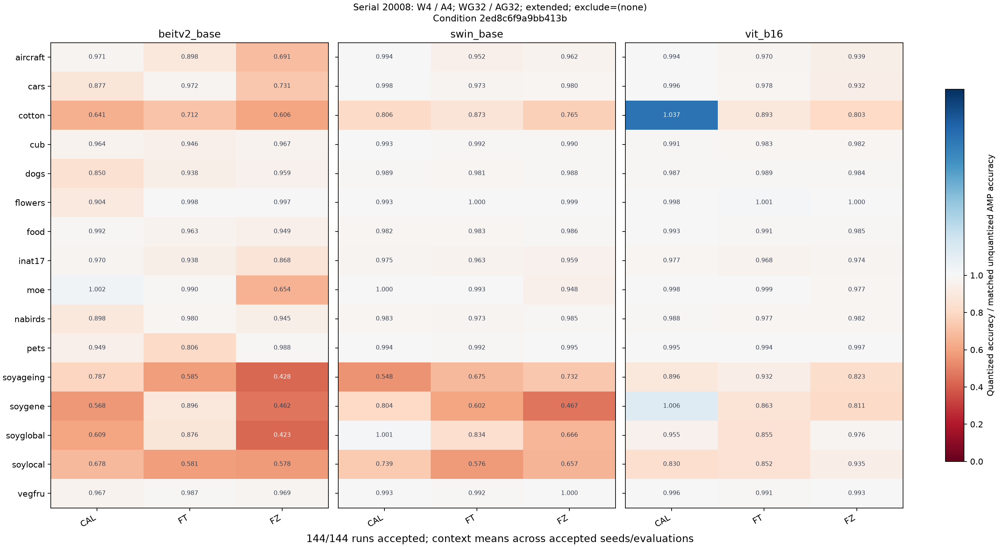
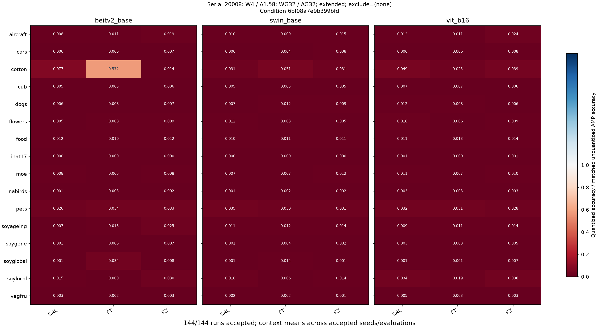
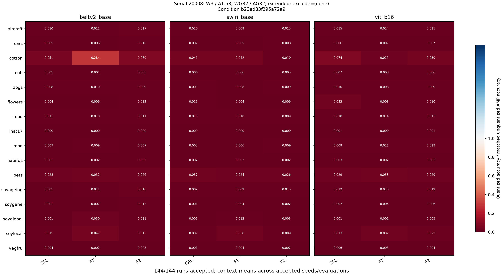
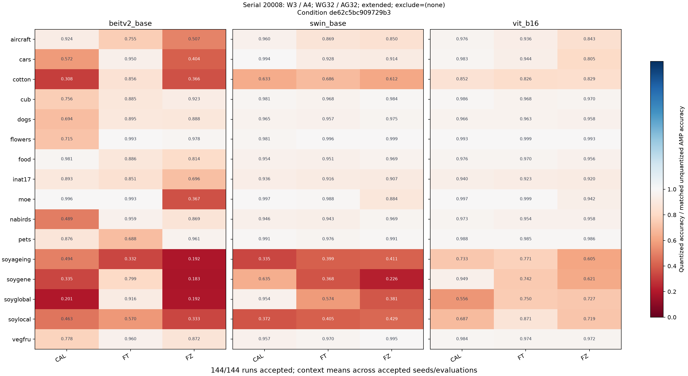
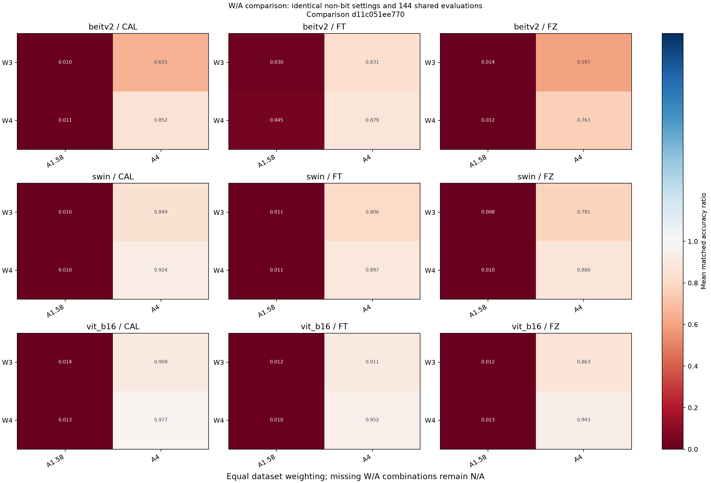

# Weight / activation quantization accuracy analysis

- Run: `20261104_103142_172229_quant_accuracy`; status: `complete`.
- Started: 2026-11-04T10:31:42.172905+08:00; finished: 2026-11-04T10:31:50.966846+08:00 (Asia/Taipei).
- Duration: 8.794 seconds.
- Input: `../../data/wandb_s20008_20261104/`; manifest SHA-256: `7e76ef2ff4705b130fc02f2e634498ed9157272f7161cd6763f035954f4bb027`.
- Full output and machine receipt: `../../result/20261104_103142_172229_quant_accuracy/run.json`.

## Source and method

W&B project: `nycu_pcs/TiT`. Analysis reads a saved config/summary snapshot; no GPU inference.
Filters: `{"activation_bits": [1.58, 4.0], "activation_group_sizes": [32], "scopes": ["extended"], "serials": [20008], "weight_bits": [3.0, 4.0], "weight_group_sizes": [32]}`.
Each condition retains weight/activation bits, group sizes, scope, exclusions, compute precision, quant flags and other recorded numerical HQQ settings.
Only explicit activation null means off; absent settings remain unrecorded. Serial is provenance, not a quantization condition.
Baseline: matched unquantized AMP fp16, using the verified copied local cohort. Match dataset, model, mode, full checkpoint path, seed, classifier, precision and recorded evaluation settings.
accuracy_ratio = quant_top1_pct / baseline_top1_pct; accuracy_drop_pp = baseline_top1_pct - quant_top1_pct. Ratios are not clipped.
Ambiguous, unfinished, invalid, duplicate or incompatible pairs remain N/A with reasons in tables/acc_ratio_pairs.csv. Missing expected contexts are in audit/missing_contexts.csv.

| Input file | SHA-256 |
|---|---|
| `baseline_selected_runs.jsonl` | `41975074b516744f58d74c1729bdfa1dd16472148fdbc23778b028b779eed603` |
| `baseline_cohort_receipt.json` | `0745d16e702d90cbfe4c5a3b25b1295b9a07583a2ed684b1e11f28e4a81247c1` |
| `baseline_input_manifest.json` | `4fa2c8983fec9da6129b130d8f1ed08ffd266ff86b96e88b96d8528ac884a608` |
| `target_runs.jsonl` | `b1c7ebb60b59dc6cb580848204fb5e8c5544d951258b6cbd0f6bcaa0387714ff` |

## Coverage and results

Accepted 576/576 target runs across 4 conditions.
Coverage: complete. Complete conditions: 4/4.
Per-condition completeness uses the expected dataset/model/mode matrix declared by the input, not the number of downloaded rows. Multiple seeds do not increase context counts.

| Condition | Settings | Accepted runs | Accepted / expected contexts | Missing |
|---|---|---:|---:|---:|
| `2ed8c6f9a9bb413b` | W4 / A4; WG32 / AG32; extended; exclude=(none) | 144/144 | 144/144 | 0 |
| `6bf08a7e9b399bfd` | W4 / A1.58; WG32 / AG32; extended; exclude=(none) | 144/144 | 144/144 | 0 |
| `b23ed83f295a72a9` | W3 / A1.58; WG32 / AG32; extended; exclude=(none) | 144/144 | 144/144 | 0 |
| `de62c5bc909729b3` | W3 / A4; WG32 / AG32; extended; exclude=(none) | 144/144 | 144/144 | 0 |

Accepted ratio summaries (descriptive only; conditions are kept separate):

| Condition | Min | Median | Max |
|---|---:|---:|---:|
| `2ed8c6f9a9bb413b` | 0.422727 | 0.969832 | 1.037037 |
| `6bf08a7e9b399bfd` | 0.000000 | 0.007460 | 0.571918 |
| `b23ed83f295a72a9` | 0.000263 | 0.008586 | 0.284247 |
| `de62c5bc909729b3` | 0.183365 | 0.916172 | 0.998996 |

Accepted pairs with different batch sizes: 264.
Heatmaps show context means across accepted seeds/evaluations. W/A comparisons hold every recorded non-bit condition setting fixed and use the same full evaluation identities and baseline IDs in every included condition.
W/A panels average per context first, then weight datasets equally. The exact shared population and excluded population sizes are recorded in audit/comparison_populations.csv.



[Editable SVG](figures/condition_2ed8c6f9a9bb413b.svg)



[Editable SVG](figures/condition_6bf08a7e9b399bfd.svg)



[Editable SVG](figures/condition_b23ed83f295a72a9.svg)



[Editable SVG](figures/condition_de62c5bc909729b3.svg)



[Editable SVG](figures/wa_d11c051ee770.svg)


## Limitations and reproduction

This is a descriptive comparison of saved evaluation summaries. Scope/head/group changes must not be interpreted as isolated bit-width effects.
Config/checkpoint-path equality does not prove identical checkpoint bytes. Matching recorded checkpoint SHA-256 values are reported separately; otherwise weights remain unverified.
Shared unrecorded evaluation fields, unknown quant settings and batch-size differences are retained in the pair audit. Remote hardware, model implementation and inference correctness were not independently verified.
Observed conditions are analyzed; an unobserved entire condition is not claimed to be covered. Missing cells within the declared expected context matrix remain N/A.
Git: `ae7dbfe0439f64c1cca9439da918a3c7504b22a3`; dirty: `True`. Code/environment/source hashes are in run.json and provenance/source/.

```powershell
conda run -n opencode_env python -m w6a4_analysis.run --input-id wandb_s20008_20261104 --weight-bits 3.0 4.0 --activation-bits 1.58 4.0 --weight-group-sizes 32 --activation-group-sizes 32 --scopes extended --serials 20008 --run-id NEW_RUN_ID
conda run -n opencode_env python -m w6a4_analysis.run --verify-run 20261104_103142_172229_quant_accuracy
```

Every rerun uses a new ID. Original inputs/runs are immutable. Report PNG/SVG copies match the full output by SHA-256.
