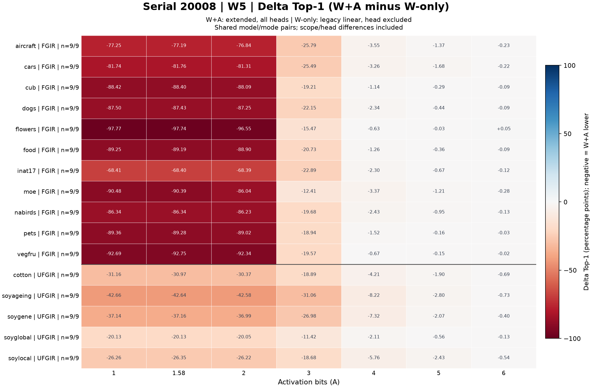
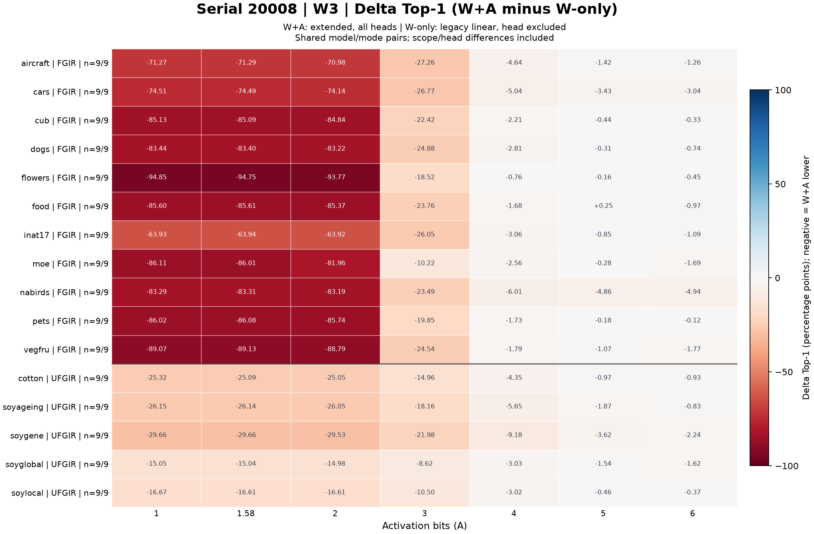
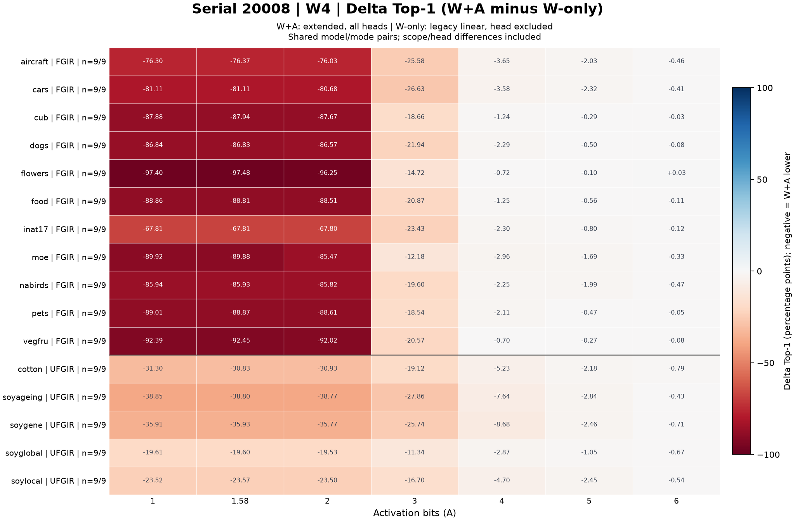

# Weight / activation quantization accuracy analysis

- Run: `20261104_s20008_weight_delta`; status: `complete`.
- Started: 2026-11-04T14:00:27.304496+08:00; finished: 2026-11-04T14:00:34.291347+08:00 (Asia/Taipei).
- Duration: 6.987 seconds.
- Input: `../../data/wandb_s20008_20261104/`; manifest SHA-256: `7e76ef2ff4705b130fc02f2e634498ed9157272f7161cd6763f035954f4bb027`.
- Full output and machine receipt: `../../result/20261104_s20008_weight_delta/run.json`.

## Source and method

W&B project: `nycu_pcs/TiT`. Analysis reads a saved config/summary snapshot; no GPU inference.
Filters: `{}`.
Each condition retains weight/activation bits, group sizes, scope, exclusions, compute precision, quant flags and other recorded numerical HQQ settings.
Only explicit activation null means off; absent settings remain unrecorded. Serial is provenance, not a quantization condition.
Baseline: matched unquantized AMP fp16, using the verified copied local cohort. Match dataset, model, mode, full checkpoint path, seed, classifier, precision and recorded evaluation settings.
accuracy_ratio = quant_top1_pct / baseline_top1_pct; accuracy_drop_pp = baseline_top1_pct - quant_top1_pct. Ratios are not clipped.
Ambiguous, unfinished, invalid, duplicate or incompatible pairs remain N/A with reasons in tables/acc_ratio_pairs.csv. Missing expected contexts are in audit/missing_contexts.csv.

| Input file | SHA-256 |
|---|---|
| `baseline_selected_runs.jsonl` | `41975074b516744f58d74c1729bdfa1dd16472148fdbc23778b028b779eed603` |
| `baseline_cohort_receipt.json` | `0745d16e702d90cbfe4c5a3b25b1295b9a07583a2ed684b1e11f28e4a81247c1` |
| `baseline_input_manifest.json` | `4fa2c8983fec9da6129b130d8f1ed08ffd266ff86b96e88b96d8528ac884a608` |
| `target_runs.jsonl` | `b1c7ebb60b59dc6cb580848204fb5e8c5544d951258b6cbd0f6bcaa0387714ff` |

## Coverage and results

Accepted 3024/3024 target runs across 21 conditions.
Coverage: complete. Complete conditions: 21/21.
Per-condition completeness uses the expected dataset/model/mode matrix declared by the input, not the number of downloaded rows. Multiple seeds do not increase context counts.

| Condition | Settings | Accepted runs | Accepted / expected contexts | Missing |
|---|---|---:|---:|---:|
| `01a5b708f6fd381a` | W5 / A6; WG32 / AG32; extended; exclude=(none) | 144/144 | 144/144 | 0 |
| `0b7dd555558d17af` | W3 / A1; WG32 / AG32; extended; exclude=(none) | 144/144 | 144/144 | 0 |
| `2ed8c6f9a9bb413b` | W4 / A4; WG32 / AG32; extended; exclude=(none) | 144/144 | 144/144 | 0 |
| `347d6ad030c57ea9` | W5 / A3; WG32 / AG32; extended; exclude=(none) | 144/144 | 144/144 | 0 |
| `4058dcb4a8602861` | W3 / A6; WG32 / AG32; extended; exclude=(none) | 144/144 | 144/144 | 0 |
| `6318819505e9dfdd` | W3 / A5; WG32 / AG32; extended; exclude=(none) | 144/144 | 144/144 | 0 |
| `6453f443efdd5029` | W5 / A1.58; WG32 / AG32; extended; exclude=(none) | 144/144 | 144/144 | 0 |
| `69d34b556c73edf7` | W4 / A2; WG32 / AG32; extended; exclude=(none) | 144/144 | 144/144 | 0 |
| `6bf08a7e9b399bfd` | W4 / A1.58; WG32 / AG32; extended; exclude=(none) | 144/144 | 144/144 | 0 |
| `999c9ff06470c051` | W4 / A3; WG32 / AG32; extended; exclude=(none) | 144/144 | 144/144 | 0 |
| `b23ed83f295a72a9` | W3 / A1.58; WG32 / AG32; extended; exclude=(none) | 144/144 | 144/144 | 0 |
| `b46e86f316d624bd` | W4 / A6; WG32 / AG32; extended; exclude=(none) | 144/144 | 144/144 | 0 |
| `c21256cb00ac84cd` | W5 / A4; WG32 / AG32; extended; exclude=(none) | 144/144 | 144/144 | 0 |
| `cac1402def4e632f` | W3 / A3; WG32 / AG32; extended; exclude=(none) | 144/144 | 144/144 | 0 |
| `cdc3b49becfc9edf` | W4 / A1; WG32 / AG32; extended; exclude=(none) | 144/144 | 144/144 | 0 |
| `cfee0e33b61b4c59` | W3 / A2; WG32 / AG32; extended; exclude=(none) | 144/144 | 144/144 | 0 |
| `de62c5bc909729b3` | W3 / A4; WG32 / AG32; extended; exclude=(none) | 144/144 | 144/144 | 0 |
| `e27eb2d1696969c4` | W5 / A2; WG32 / AG32; extended; exclude=(none) | 144/144 | 144/144 | 0 |
| `e74e3f75c9c6dbb3` | W5 / A5; WG32 / AG32; extended; exclude=(none) | 144/144 | 144/144 | 0 |
| `fa9f838949b96c7c` | W4 / A5; WG32 / AG32; extended; exclude=(none) | 144/144 | 144/144 | 0 |
| `fcacbd1c3e4f6fb9` | W5 / A1; WG32 / AG32; extended; exclude=(none) | 144/144 | 144/144 | 0 |

Accepted ratio summaries (descriptive only; conditions are kept separate):

| Condition | Min | Median | Max |
|---|---:|---:|---:|
| `01a5b708f6fd381a` | 0.777273 | 0.997915 | 1.284247 |
| `0b7dd555558d17af` | 0.000000 | 0.007802 | 0.428082 |
| `2ed8c6f9a9bb413b` | 0.422727 | 0.969832 | 1.037037 |
| `347d6ad030c57ea9` | 0.007576 | 0.743129 | 1.140411 |
| `4058dcb4a8602861` | 0.214241 | 0.940457 | 0.999271 |
| `6318819505e9dfdd` | 0.287691 | 0.948798 | 1.140411 |
| `6453f443efdd5029` | 0.000398 | 0.007342 | 0.856164 |
| `69d34b556c73edf7` | 0.000280 | 0.012046 | 1.000000 |
| `6bf08a7e9b399bfd` | 0.000000 | 0.007460 | 0.571918 |
| `999c9ff06470c051` | 0.010712 | 0.719993 | 1.568493 |
| `b23ed83f295a72a9` | 0.000263 | 0.008586 | 0.284247 |
| `b46e86f316d624bd` | 0.737879 | 0.991704 | 1.061630 |
| `c21256cb00ac84cd` | 0.365909 | 0.979547 | 1.140411 |
| `cac1402def4e632f` | 0.004545 | 0.636883 | 1.000000 |
| `cdc3b49becfc9edf` | 0.000000 | 0.007680 | 0.284247 |
| `cfee0e33b61b4c59` | 0.000000 | 0.011710 | 0.856164 |
| `de62c5bc909729b3` | 0.183365 | 0.916172 | 0.998996 |
| `e27eb2d1696969c4` | 0.000000 | 0.011912 | 0.856164 |
| `e74e3f75c9c6dbb3` | 0.481439 | 0.994051 | 1.140411 |
| `fa9f838949b96c7c` | 0.335854 | 0.987480 | 1.140411 |
| `fcacbd1c3e4f6fb9` | 0.000000 | 0.007513 | 0.571918 |

Accepted pairs with different batch sizes: 1386.
Heatmaps show context means across accepted seeds/evaluations. W/A comparisons hold every recorded non-bit condition setting fixed and use the same full evaluation identities and baseline IDs in every included condition.
W/A panels average per context first, then weight datasets equally. The exact shared population and excluded population sizes are recorded in audit/comparison_populations.csv.


## W+A minus weight-only delta

delta_top1_pp = W+A Top-1 (%) - weight-only Top-1 (%). Negative means the W+A evaluation scored lower. delta_accuracy_ratio is also saved as delta_top1_pp / matched AMP Top-1.
Matched comparisons: 3024/3024; distinct weight-only runs: 432.
IMPORTANT: W+A serial 20008 is extended scope with all heads included. The verified historical weight-only cohort is legacy linear scope with head excluded. This is a descriptive difference between those settings, NOT an isolated activation-quantization effect.
Only W bits/group size, compute dtype, quant-zero/scale, precision and full evaluation identity plus the same AMP baseline are matched. Other quantization differences are retained in quant_setting_differences in tables/weight_delta_pairs.csv.
The weight-only source is the preserved recover_baselines selected cohort. Its documented source contract allows historical missing activation/scope fields as legacy weight-only linear; this rule is not applied to arbitrary new exports.
Each cell first computes per-evaluation differences, then averages seeds/evaluations within model/mode, then weights model/mode contexts equally. Across A, use the same evaluation identities AND the same weight-only run IDs. Missing/ambiguous comparisons remain N/A.
All three plots share a zero-centered -100 to +100 percentage-point scale. FGIR/UFGIR display order follows the supplied reference image and does not change canonical research groups.
Raw paired values, IDs, source serials, settings and reasons are in tables/weight_delta_pairs.csv; comparator records are in tables/weight_only_pairs.csv; exact shared populations are in audit/weight_delta_populations.csv.



[Editable SVG](figures/weight_delta_w5_04e1e635390b.svg)



[Editable SVG](figures/weight_delta_w3_50654e9ab99f.svg)



[Editable SVG](figures/weight_delta_w4_ef33a79ef60b.svg)


## Limitations and reproduction

This is a descriptive comparison of saved evaluation summaries. Scope/head/group changes must not be interpreted as isolated bit-width effects.
Config/checkpoint-path equality does not prove identical checkpoint bytes. Matching recorded checkpoint SHA-256 values are reported separately; otherwise weights remain unverified.
Shared unrecorded evaluation fields, unknown quant settings and batch-size differences are retained in the pair audit. Remote hardware, model implementation and inference correctness were not independently verified.
Observed conditions are analyzed; an unobserved entire condition is not claimed to be covered. Missing cells within the declared expected context matrix remain N/A.
Git: `ae7dbfe0439f64c1cca9439da918a3c7504b22a3`; dirty: `True`. Code/environment/source hashes are in run.json and provenance/source/.

```powershell
conda run -n opencode_env python -m w6a4_analysis.run --input-id wandb_s20008_20261104 --weight-delta --run-id NEW_RUN_ID
conda run -n opencode_env python -m w6a4_analysis.run --verify-run 20261104_s20008_weight_delta
```

Every rerun uses a new ID. Original inputs/runs are immutable. Report PNG/SVG copies match the full output by SHA-256.
