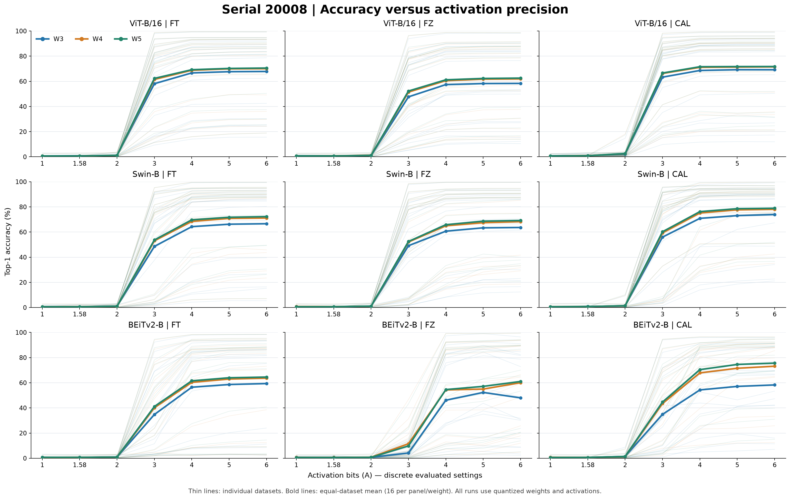
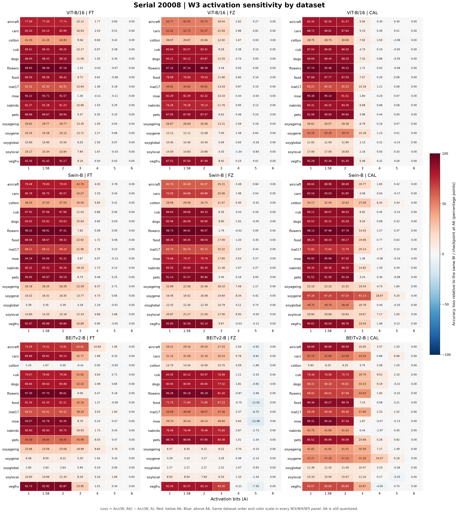
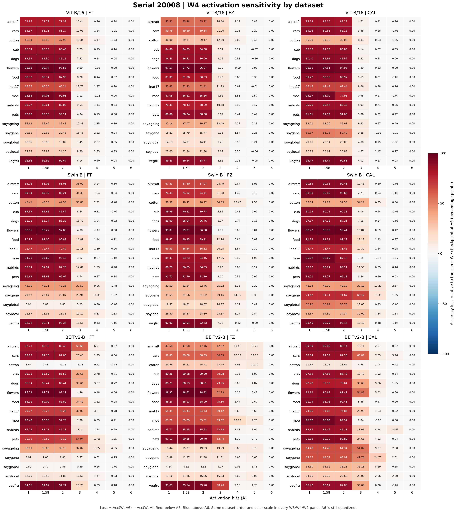
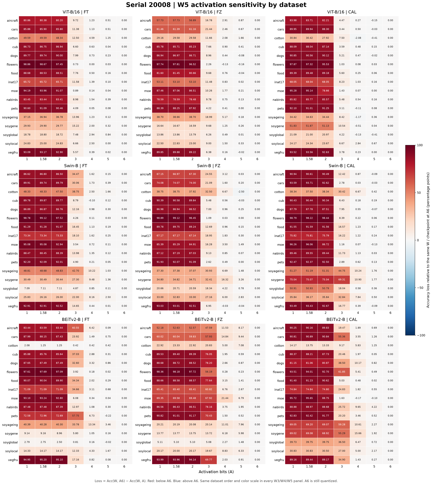

# W&B serial 20008 簡要分析

分析時間：2026-11-02T14:25:45.952084+08:00（Asia/Taipei）。

來源：W&B `nycu_pcs/TiT`，Public API 全量 config/summary；target filter `config.serial=20008`。
輸入：`data/wandb_s20008_20261102_135933_037365/source_manifest.json`；指標 `hqq_top1`，單位為 %。

## 範圍與方法

3,024/3,024 finished；16 datasets × 3 models × FT/FZ/CAL × W3/4/5 × A1/1.58/2/3/4/5/6。
Weight/activation G32、extended、head 納入、AMP fp16。平均值為每個 context 等權，不依測試樣本數加權。
逐 checkpoint 核對完整路徑、dataset、model/mode、seed、classifier、precision 與既有 evaluation fields；W/A 比較保持這些設定一致。

## Activation 觀察圖

### 1. Accuracy–activation bits

九個面板分開 model × FT/FZ/CAL；W3/W4/W5 各一色。淡線是個別 dataset，粗線是同一組 16 datasets 的等權平均；不是信賴區間。



### 2. 各 dataset 相對 A6 的損傷

`loss_vs_a6_pp = Acc(相同 checkpoint, W, A6) - Acc(相同 checkpoint, W, A)`。
正值（紅）代表比 A6 差，負值（藍）代表比 A6 好；不截斷、不強制單調。三張圖共用 dataset 順序及對稱色階。
**A6 仍有 activation quantization；此圖不是相對未量化 activation 的完整損傷，也不使用缺失的 FP baseline 補值。**







完整 PNG／可編輯 SVG 與四頁 PDF `activation_observation_atlas.pdf` 位於本次 result 的 figures/。
Plot coverage：3024 個配對點，127 個負值，189 個平均點，每點 16 datasets。

## W/A 平均 Top-1 (%)

| a | 3 | 4 | 5 |
| --- | --- | --- | --- |
| 1.000 | 0.687 | 0.680 | 0.667 |
| 1.580 | 0.714 | 0.706 | 0.693 |
| 2.000 | 1.183 | 1.224 | 1.253 |
| 3.000 | 44.069 | 48.751 | 49.240 |
| 4.000 | 60.597 | 65.710 | 66.695 |
| 5.000 | 62.866 | 67.595 | 68.758 |
| 6.000 | 62.793 | 68.643 | 69.592 |

## 模型 × activation 平均 Top-1 (%)

| a | beitv2_base_patch16_224 | swin_base_patch4_window7_224_in22k | vit_b16 |
| --- | --- | --- | --- |
| 1.000 | 0.697 | 0.653 | 0.685 |
| 1.580 | 0.655 | 0.681 | 0.776 |
| 2.000 | 1.020 | 1.139 | 1.501 |
| 3.000 | 29.387 | 53.840 | 58.833 |
| 4.000 | 58.424 | 68.453 | 66.124 |
| 5.000 | 61.451 | 70.836 | 66.933 |
| 6.000 | 62.623 | 71.328 | 67.076 |

## FT/FZ/CAL × activation 平均 Top-1 (%)

| a | cal | ft | fz |
| --- | --- | --- | --- |
| 1.000 | 0.687 | 0.657 | 0.691 |
| 1.580 | 0.748 | 0.687 | 0.678 |
| 2.000 | 1.725 | 0.998 | 0.936 |
| 3.000 | 54.964 | 50.370 | 36.726 |
| 4.000 | 69.565 | 65.038 | 58.399 |
| 5.000 | 71.633 | 66.906 | 60.680 |
| 6.000 | 72.259 | 67.329 | 61.438 |

## 同 checkpoint、同 weight 的 activation 成對增量

| index | from_a | to_a | n | mean_gain_pp | median_gain_pp | improved | worsened | tied |
| --- | --- | --- | --- | --- | --- | --- | --- | --- |
| 0 | 1.000 | 1.580 | 432 | 0.026 | 0.000 | 207 | 176 | 49 |
| 1 | 1.580 | 2.000 | 432 | 0.516 | 0.155 | 334 | 68 | 30 |
| 2 | 2.000 | 3.000 | 432 | 46.133 | 49.860 | 426 | 6 | 0 |
| 3 | 3.000 | 4.000 | 432 | 16.981 | 10.655 | 429 | 2 | 1 |
| 4 | 4.000 | 5.000 | 432 | 2.072 | 0.970 | 395 | 32 | 5 |
| 5 | 5.000 | 6.000 | 432 | 0.603 | 0.210 | 316 | 95 | 21 |

## 未量化 AMP baseline

144 contexts 的配對 coverage：{'matched': 109, 'missing': 25, 'ambiguous': 10}。僅唯一且 config 相容者計算 drop/ratio；缺失與多個相容候選保留 N/A，不任選 baseline。
完整候選與 mismatch、checkpoint、run URL 皆保存於 `runs_and_baseline_audit.csv`。

| a | w | n | baseline_mean | quant_mean | mean_drop_pp | mean_accuracy_ratio |
| --- | --- | --- | --- | --- | --- | --- |
| 1.000 | 3 | 109 | 65.622 | 0.630 | 64.992 | 0.015 |
| 1.000 | 4 | 109 | 65.622 | 0.616 | 65.006 | 0.013 |
| 1.000 | 5 | 109 | 65.622 | 0.604 | 65.018 | 0.015 |
| 1.580 | 3 | 109 | 65.622 | 0.625 | 64.998 | 0.014 |
| 1.580 | 4 | 109 | 65.622 | 0.625 | 64.997 | 0.016 |
| 1.580 | 5 | 109 | 65.622 | 0.605 | 65.018 | 0.018 |
| 2.000 | 3 | 109 | 65.622 | 0.909 | 64.713 | 0.023 |
| 2.000 | 4 | 109 | 65.622 | 0.913 | 64.709 | 0.024 |
| 2.000 | 5 | 109 | 65.622 | 0.955 | 64.667 | 0.024 |
| 3.000 | 3 | 109 | 65.622 | 34.859 | 30.763 | 0.466 |
| 3.000 | 4 | 109 | 65.622 | 39.969 | 25.653 | 0.543 |
| 3.000 | 5 | 109 | 65.622 | 40.405 | 25.218 | 0.548 |
| 4.000 | 3 | 109 | 65.622 | 53.954 | 11.669 | 0.752 |
| 4.000 | 4 | 109 | 65.622 | 60.163 | 5.459 | 0.871 |
| 4.000 | 5 | 109 | 65.622 | 61.364 | 4.258 | 0.899 |
| 5.000 | 3 | 109 | 65.622 | 56.713 | 8.909 | 0.811 |
| 5.000 | 4 | 109 | 65.622 | 62.444 | 3.179 | 0.922 |
| 5.000 | 5 | 109 | 65.622 | 63.882 | 1.740 | 0.953 |
| 6.000 | 3 | 109 | 65.622 | 56.587 | 9.035 | 0.808 |
| 6.000 | 4 | 109 | 65.622 | 63.779 | 1.843 | 0.953 |
| 6.000 | 5 | 109 | 65.622 | 64.937 | 0.686 | 0.983 |

## 解讀與限制

- A≤2 的平均 accuracy 僅約 0.7–1.3%；A3 才明顯恢復，A4→A6 的額外收益較小。
- A3 時 BEiTv2 的絕對 accuracy 明顯低於另外兩種模型；跨模型 robustness 仍須看完整 matched baseline，不能只靠絕對 accuracy 排名。
- W3 在 A5→A6 的平均 accuracy 略降；bit 數提高不保證每個條件單調改善。
- 現行 TGDA launcher 文件說明 post_softmax_no_patch_v1，但 W&B config/summary 沒有 coverage.protocol；未讀取 server evaluation.json，故本分析無法逐 run 驗證插點或 patch 排除。
- 不以 serial 20007 當控制組：其 W/A 設定與歷史 protocol 不同。
- 未取得 checkpoint bytes hashes、逐樣本預測或 features；不作因果定位、統計顯著性或 integer-kernel 效能宣稱。
- Baseline 是未量化 AMP，並非純 FP32；coverage 不完整，部分 batch size 不同。
- 每個 context 只有一組 checkpoint/seed；跨 datasets 平均僅為描述性摘要。

## 重現

```powershell
& "C:\Users\Public\miniconda3\envs\opencode_env\python.exe" -B -m activation_quantization.run --input-id wandb_s20008_20261102_135933_037365 --run-id NEW_RUN_ID
& "C:\Users\Public\miniconda3\envs\opencode_env\python.exe" -B -m activation_quantization.run --verify-run 20261102_142515_734861_wa_s20008
```
