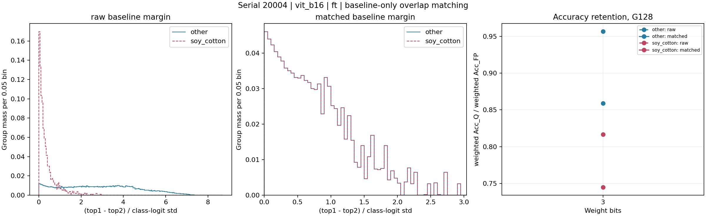
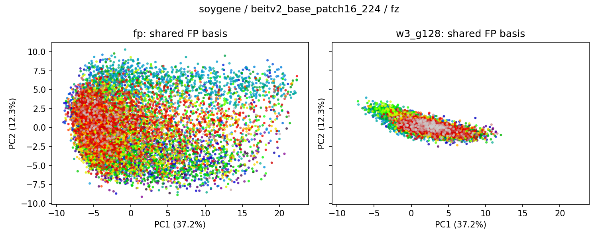
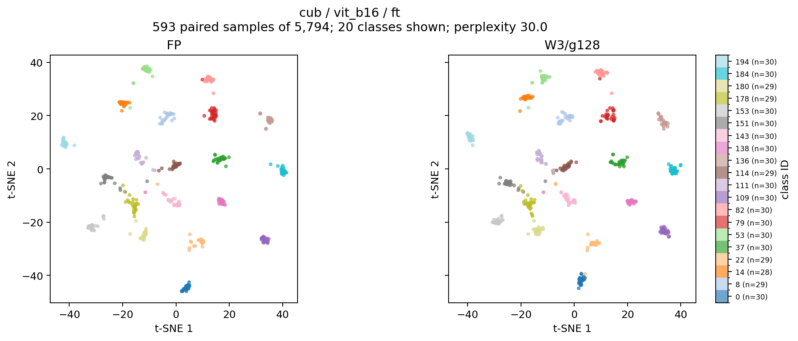

# W3/G128 Nano4 run_all：下載結果核對與論文資料交付

核對時間：2026-11-16T14:20:39.819843+08:00（Asia/Taipei）。

來源 run：`20261115_211022_759540_w3_s20004`。本機核對 ID：`20261116_140853_554056_runall_s20004_audit`。

結論：此下載包的完整性與可重算的數值一致性通過；可作為論文 W3/G128 機制分析資料。這不等於已驗證全部原始 inference 或已建立因果結論。

## 資料身分與方法

- 壓縮檔：`20261115_211022_759540_w3_s20004_analysis_20261116_140016.tar.gz`。
- SHA-256：`99c61da30c96b21648409763f26875fab187da46febede8e752e41ec6af3edb4`。gzip CRC 與安全解包通過；保留原始壓縮檔。
- 解包共 1,706 個檔案、255,743,708 bytes（約 255.7 MB）。
- 16 datasets × 3 models × FT/FZ/CAL，共 144 FP/Q contexts；FT/FZ 各 48 組舊格式，CAL 48 組 schema 2，來源 serial 全部為 20004。
- 評估 coverage 記錄 inference seed=100、AMP FP16、HQQ compute dtype=float16；FP 不解讀為純 FP32。
- Server 開始：2026-11-15T21:10:23.051233+08:00；完成：2026-11-15T23:59:14.091081+08:00；11 個 preflight/analysis 紀錄均 complete、exit code 0。
- 核對方式：所有 receipt output hashes、程式快照、圖片格式及 CRC；跨 paired/centered/bias/margin 對齊 dataset/model/mode；檢查比例、count、damage/rescue 與 PCA/CKA；依保存的 sample margins 獨立重建三種 bin width 的 matching weights。未重新 inference。

## 完整性與數值檢查

| 項目 | 結果 |
|---|---|
| Receipt hashes | 1,695 個相異產物／程式路徑，0 mismatch |
| 全部匯入檔案 | 1,706 個檔案均核對匯入 hash，核對期間原始 bytes 未變 |
| Paired | 144 組、4,896 列逐層指標；accuracy/loss、damage/rescue、summary/global 一致 |
| PCA | 144 組 basis、288 份 full coordinates；shape、finite、orthogonality、FP coordinate mean 通過 |
| Centered geometry | 144 組；raw geometry、FP mean 與 paired PCA mean 一致，centered ratios/gaps 一致 |
| t-SNE | 144 組；coordinates、sample/class counts、跨 model/mode class IDs 一致 |
| PNG | 306 張皆通過圖片完整性檢查；另目視核對本報告引用的 3 張圖 |
| Bias | 144 組；720 個 fold records，weighted gains 和 paired counts 一致 |
| Prediction status | 576 列 status 全為 ok；18 組設定 summary 完整 |
| Margin | 108 列 group metrics、288 列 dataset metrics，全部 status=ok；三種 bin width 的樣本權重、ESS、histograms 與群組彙整一致 |
| Matching histogram | 最大 balance error 7.88e-14 |

## Model/mode 描述性摘要

以下 FP/Q accuracy 與 bias gain 均為 16 個 datasets 等權平均；relative loss 與 CKA 為中位數。不同 model/mode 重用相同 datasets，不當成獨立重複。

| Model | Mode | Mean FP acc (%) | Mean Q acc (%) | Median relative loss (%) | Median final CKA | Mean bias gain (pp) |
|---|---|---:|---:|---:|---:|---:|
| BEiTv2 | cal | 76.36 | 50.10 | 44.76 | 0.857 | +11.313 |
| BEiTv2 | ft | 64.97 | 50.38 | 25.67 | 0.778 | +2.783 |
| BEiTv2 | fz | 62.92 | 12.28 | 89.42 | 0.160 | +2.060 |
| Swin-B | cal | 79.28 | 70.73 | 5.13 | 0.903 | +2.466 |
| Swin-B | ft | 72.52 | 62.62 | 9.26 | 0.866 | +1.914 |
| Swin-B | fz | 69.65 | 59.53 | 10.60 | 0.913 | +4.150 |
| ViT-B16 | cal | 72.04 | 67.28 | 3.53 | 0.952 | +1.294 |
| ViT-B16 | ft | 70.75 | 65.52 | 6.10 | 0.881 | +0.641 |
| ViT-B16 | fz | 62.81 | 56.14 | 8.49 | 0.913 | +1.524 |

## Margin matching：主分析 bin width=0.05

Gap 定義為 other retention ratio − soy/cotton retention ratio。兩組原始每個 dataset 等權；匹配後各 dataset mass 會改變。

| Model | Mode | Raw gap (ratio) | Matched gap (ratio) | Absolute gap reduction (%) |
|---|---|---:|---:|---:|
| ViT-B16 | ft | 0.2119 | 0.0425 | 80.0 |
| ViT-B16 | fz | 0.3097 | 0.1883 | 39.2 |
| ViT-B16 | cal | 0.2683 | 0.1184 | 55.9 |
| Swin-B | ft | 0.4984 | 0.2480 | 50.2 |
| Swin-B | fz | 0.5688 | 0.4117 | 27.6 |
| Swin-B | cal | 0.3409 | 0.1120 | 67.1 |
| BEiTv2 | ft | 0.4077 | 0.1881 | 53.9 |
| BEiTv2 | fz | 0.1839 | 0.0783 | 57.4 |
| BEiTv2 | cal | 0.3248 | 0.0608 | 81.3 |

9/9 設定的 gap 都縮小，幅度約 27.6%–81.3%；這是共同支撐區域下的描述性結果。Matching 同時改變 sample weights、dataset 組成與 FP accuracy，不能據此聲稱 margin 已因果解釋全部 dataset 差異。

## 需要保留的限制與後續核對

1. **AUROC 未定義不是流程失敗。** 1,152 列 score 中有 8 列 `undefined_single_class`，均為 BEiTv2/FZ 的 cotton 或 soylocal damage 預測。這些測試子集的 damage event rate=1，無法計算 AUROC；原始 NA 保留，不能補成 0 或 0.5。其餘 Brier/log-loss 有定義。
2. **Competitors 並非每種設定都更好。** ViT/FT 的 LODO damage mean ΔBrier=+0.003710，表示此設定平均較差；其他設定也需依 Brier/log-loss/AUROC 分別判讀，不只選擇正向結果。
3. **Matching 有有效樣本數成本。** 最低 matched/raw ESS 約 20.8%；最大 weight multiplier 約 5.20。ESS/N 最低約 4.05%，但 dataset 等權本身也會降低 raw ESS，不能把 ESS/N 直接稱為實際樣本保留比例。
4. **BEiTv2/FZ 明顯退化。** Mean FP/Q accuracy 為 62.92%/12.28%，median relative loss=89.42%。數值、CKA 和 PCA 方向一致，未見跨表格錯配；仍需對照本機 full grid 的同 checkpoint/precision/head exclusion 結果。
5. **2D PCA 視覺化的資訊量不同。** 38/144 contexts 的前兩軸 variance sum<10%；最低為 inat17/Swin/FT 的 1.50%。PCA 圖與 t-SNE 只作輔助，完整維度指標保留為主要數值依據。
6. **Raw inference 仍在 server。** 本包未含原始逐層 features、full logits、predictions/samples 快照及 CAL 原始 condition manifests；因此只能獨立驗證下載的產物與可由 sample weights 重建的運算，不能在本機重新推論或完整重算 CKA/投影/logit-bias。CAL classifier exclusion 的 server preflight 已記錄成功，但仍需原始 coverage manifest 才能在本機獨立重驗。
7. **Bias correction 是回顧性診斷。** Protocol 記錄 test-logit five-fold crossfit，不當成未接觸 test data 的部署修正 accuracy。LODO competitors 也應維持原本 damage conditional-on-FP-correct 等定義。
8. **程式來源差異已核對。** 35 份 snapshots 中 26 份只差 CRLF/LF、8 份 byte-identical；唯一額外差異為 Slurm account（server MST115190/local MST114495）。Python 分析方法未發現語法樹差異。原始 server 快照保持原樣。
9. **研究範圍仍是 W3/G128、單一 inference seed。** 本包未取代 full weight grid、dataset static attributes、matched-N CKA 或舊 sample-margin decile/AUROC 分析。此處的未定義 AUROC 指既有 competitor 模型評分，不是舊 decile/AUROC 流程已完成。

## 論文資料包入口

- `data/run_all/20261115_211022_759540_w3_s20004/`：原始下載的五個分析產物、完整 coordinates、sample weights、logs、receipts、code snapshots，維持相對路徑與 bytes。
- `data/derived/20261116_140853_554056_runall_s20004_audit/dataset_master.csv`：144 列整合主表，可接本機 full-grid 與 static attributes。
- `model_mode_summary.csv`：9 組描述性摘要；`margin_primary_summary.csv`：9 組主 matching 結果。
- `matching_support_summary.csv`：三種 bin widths 的 overlap、ESS、raw ESS、weight amplification；`undefined_auroc.csv`：保留的 8 列 NA。
- `source_code_comparison.csv`：本機與 server code snapshots 比較；`verification.json`、`hash_verification.csv`、input source manifest：核對與來源紀錄。
- 不改寫 Linux 原始來源路徑，使用交付 manifest 記錄本機 relocation；讀取資料請以本資料包的相對路徑定位。

## 重現本次核對

核對程式保存在交付的 audit provenance；它僅讀取原始資料、產出 derived tables 與核對紀錄，不重新執行 server inference。Python、NumPy/pandas 版本及 command 見 audit run.json。要在其他目錄重現，需依 relocation manifest 提供實際輸入根目錄，不能直接沿用保存的歷史絕對路徑。
