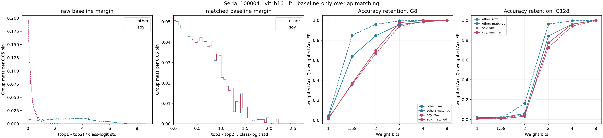

# Baseline normalized-margin matching

Status: **complete**; run ID: `20261022_margin_s100004_verified`.
Start: 2026-10-22T11:24:01.757489+08:00; finish: 2026-10-22T11:25:03.688413+08:00; timezone: Asia/Taipei.
Elapsed: 61.93 s.
Input: `C:\project\quant_analysis\hqq_confidence\data\serial100004_archive_20261022`; source manifest SHA-256: `f7a8143b81dc08fda0b284dc3748b540be31d49477ecbd9d2b165ab535e4170f`.
Source serial: 100004; upstream: `C:\project\quant_analysis\outputs\worktree_archive\20261021-154622\serial-100004-logits-analysis\files\hqq_confidence\data\serial_100004`.
Full file identity, sizes and SHA-256 are in provenance/source_manifest.json and run.json.
Group mapping: `{"soy": ["soyageing", "soygene", "soyglobal", "soylocal"], "other": ["aircraft", "cars", "cub", "dogs", "flowers", "food", "moe", "nabirds", "pets", "vegfru"]}`.

## Method

Each model/checkpoint mode is analyzed separately. Original weights give each dataset equal mass within its group.
Baseline normalized margin = (highest - second-highest logit) / population std of all class logits (ddof=0).
Primary width 0.05; sensitivity widths 0.025 and 0.10. Bins are half-open [k*w,(k+1)*w).
q[b] = min(p_focus[b],p_other[b]) / sum(min); sample weight = 1/(D_group*N_dataset) * q[b]/p_group[b].
Identical weights apply to FP and Q correctness. Accuracy ratio = weighted Acc_Q / weighted Acc_FP.
Accuracies, drops, damage/rescue masses and ratios are fractions. Gap is Other minus focus; multiply by 100 for ratio percentage points.
damage_rate/rescue_rate in these tables are unconditional weighted sample masses; Q = FP - damage + rescue.
Zero baseline accuracy and absent common support produce N/A. Missing input cells/checksum/pairing mismatches fail the run.

## Primary results

| Model | Mode | Condition | Group | Weighting | FP | Q | Ratio | Status |
|---|---|---|---|---|---:|---:|---:|---|
| vit_b16 | ft | hqq_n1_g8 | other | raw | 0.90270 | 0.03798 | 0.04208 | ok |
| vit_b16 | ft | hqq_n1_g8 | soy | raw | 0.28240 | 0.00613 | 0.02169 | ok |
| vit_b16 | ft | hqq_n1_g8 | other | matched | 0.60300 | 0.01761 | 0.02920 | ok |
| vit_b16 | ft | hqq_n1_g8 | soy | matched | 0.47539 | 0.00626 | 0.01317 | ok |
| vit_b16 | ft | hqq_n1_g128 | other | raw | 0.90270 | 0.00742 | 0.00822 | ok |
| vit_b16 | ft | hqq_n1_g128 | soy | raw | 0.28240 | 0.00425 | 0.01504 | ok |
| vit_b16 | ft | hqq_n1_g128 | other | matched | 0.60300 | 0.01109 | 0.01839 | ok |
| vit_b16 | ft | hqq_n1_g128 | soy | matched | 0.47539 | 0.00456 | 0.00960 | ok |
| vit_b16 | ft | hqq_n1.58_g8 | other | raw | 0.90270 | 0.76740 | 0.85012 | ok |
| vit_b16 | ft | hqq_n1.58_g8 | soy | raw | 0.28240 | 0.10136 | 0.35894 | ok |
| vit_b16 | ft | hqq_n1.58_g8 | other | matched | 0.60300 | 0.38466 | 0.63791 | ok |
| vit_b16 | ft | hqq_n1.58_g8 | soy | matched | 0.47539 | 0.17453 | 0.36714 | ok |
| vit_b16 | ft | hqq_n1.58_g128 | other | raw | 0.90270 | 0.00927 | 0.01027 | ok |
| vit_b16 | ft | hqq_n1.58_g128 | soy | raw | 0.28240 | 0.00387 | 0.01371 | ok |
| vit_b16 | ft | hqq_n1.58_g128 | other | matched | 0.60300 | 0.01053 | 0.01747 | ok |
| vit_b16 | ft | hqq_n1.58_g128 | soy | matched | 0.47539 | 0.00277 | 0.00582 | ok |
| vit_b16 | ft | hqq_n2_g8 | other | raw | 0.90270 | 0.86546 | 0.95875 | ok |
| vit_b16 | ft | hqq_n2_g8 | soy | raw | 0.28240 | 0.18786 | 0.66522 | ok |
| vit_b16 | ft | hqq_n2_g8 | other | matched | 0.60300 | 0.50974 | 0.84535 | ok |
| vit_b16 | ft | hqq_n2_g8 | soy | matched | 0.47539 | 0.33202 | 0.69842 | ok |
| vit_b16 | ft | hqq_n2_g128 | other | raw | 0.90270 | 0.14712 | 0.16298 | ok |
| vit_b16 | ft | hqq_n2_g128 | soy | raw | 0.28240 | 0.01285 | 0.04549 | ok |
| vit_b16 | ft | hqq_n2_g128 | other | matched | 0.60300 | 0.03606 | 0.05980 | ok |
| vit_b16 | ft | hqq_n2_g128 | soy | matched | 0.47539 | 0.01525 | 0.03207 | ok |
| vit_b16 | ft | hqq_n3_g8 | other | raw | 0.90270 | 0.89713 | 0.99384 | ok |
| vit_b16 | ft | hqq_n3_g8 | soy | raw | 0.28240 | 0.26574 | 0.94100 | ok |
| vit_b16 | ft | hqq_n3_g8 | other | matched | 0.60300 | 0.57710 | 0.95704 | ok |
| vit_b16 | ft | hqq_n3_g8 | soy | matched | 0.47539 | 0.46425 | 0.97656 | ok |
| vit_b16 | ft | hqq_n3_g128 | other | raw | 0.90270 | 0.86735 | 0.96084 | ok |
| vit_b16 | ft | hqq_n3_g128 | soy | raw | 0.28240 | 0.20433 | 0.72357 | ok |
| vit_b16 | ft | hqq_n3_g128 | other | matched | 0.60300 | 0.50700 | 0.84081 | ok |
| vit_b16 | ft | hqq_n3_g128 | soy | matched | 0.47539 | 0.36723 | 0.77249 | ok |
| vit_b16 | ft | hqq_n4_g8 | other | raw | 0.90270 | 0.90096 | 0.99808 | ok |
| vit_b16 | ft | hqq_n4_g8 | soy | raw | 0.28240 | 0.27886 | 0.98747 | ok |
| vit_b16 | ft | hqq_n4_g8 | other | matched | 0.60300 | 0.59328 | 0.98389 | ok |
| vit_b16 | ft | hqq_n4_g8 | soy | matched | 0.47539 | 0.47419 | 0.99747 | ok |
| vit_b16 | ft | hqq_n4_g128 | other | raw | 0.90270 | 0.89729 | 0.99401 | ok |
| vit_b16 | ft | hqq_n4_g128 | soy | raw | 0.28240 | 0.26579 | 0.94118 | ok |
| vit_b16 | ft | hqq_n4_g128 | other | matched | 0.60300 | 0.57922 | 0.96057 | ok |
| vit_b16 | ft | hqq_n4_g128 | soy | matched | 0.47539 | 0.45642 | 0.96009 | ok |
| vit_b16 | ft | hqq_n8_g8 | other | raw | 0.90270 | 0.90268 | 0.99998 | ok |
| vit_b16 | ft | hqq_n8_g8 | soy | raw | 0.28240 | 0.28183 | 0.99799 | ok |
| vit_b16 | ft | hqq_n8_g8 | other | matched | 0.60300 | 0.60290 | 0.99984 | ok |
| vit_b16 | ft | hqq_n8_g8 | soy | matched | 0.47539 | 0.47524 | 0.99969 | ok |
| vit_b16 | ft | hqq_n8_g128 | other | raw | 0.90270 | 0.90247 | 0.99974 | ok |
| vit_b16 | ft | hqq_n8_g128 | soy | raw | 0.28240 | 0.28103 | 0.99515 | ok |
| vit_b16 | ft | hqq_n8_g128 | other | matched | 0.60300 | 0.60166 | 0.99778 | ok |
| vit_b16 | ft | hqq_n8_g128 | soy | matched | 0.47539 | 0.47504 | 0.99926 | ok |

Validation: `{"settings": 1, "source_files": 183, "max_histogram_balance_error": 2.1788126858268697e-14, "undefined_estimates": 0, "source_hashes_rechecked": true, "formula_checks": true, "report_figure_hashes_equal": true}`.

Balance, ESS, support, weighted KS and dataset-composition changes are in tables/diagnostics.csv, balance.csv and dataset_weights.csv.

## Limits

This is descriptive standardization of observed test samples, not a causal decomposition or a significance test.
Bin proportions match, not individual continuous margins. Matching changes dataset masses and effective sample sizes.
FP correctness, class count, checkpoint training, preprocessing and quantization perturbations can remain different.
Conclusions cover only common support. Cotton is part of the requested comparison group, not a soybean dataset.
Baseline precision is recorded per setting in coverage.csv; AMP-FP16 is not pure FP32. CAL retains exported evaluation aggregation.
Checkpoint/test-CSV hashes are exporter declarations; original weights/images and inference are not re-executed.
Models and modes reuse datasets and are not independent replications. No new inference or W&B download.



## Reproduce

```bash
conda run -n opencode_env python -m hqq_confidence.analyze_margin_matching run --input-id serial100004_archive_20261022 --run-id 20261022_margin_s100004_verified --serial 100004 --grouping legacy-soy
```

Git: `c90f9052f8ef7c6d29789674fc51e4d7ffcfa660`; dirty: `True`.
Exact source copies: result/<run_id>/provenance/source/. Use a new run ID for reruns.
Full output: `C:\project\quant_analysis\hqq_confidence\result\20261022_margin_s100004_verified`.
