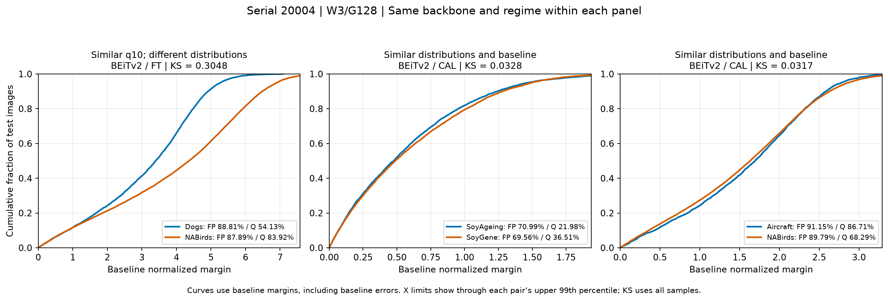

# 論文問答筆記：baseline、logit margin 與量化準確率

整理日期：2026-11-16（Asia/Taipei）。本筆記彙整本次對論文提出的問題、已核對數據、解讀修正與後續待辦，不是新增的實驗論文結果。

## 1. 原稿與閱讀入口

- **英文原稿**：[Dataset-Dependent Accuracy Retention under Weight-Only Post-Training Quantization](manuscripts/20261116_short/short.pdf)。7 頁；WACV 2027 Algorithms Track 匿名草稿。
- **來源版本**：[SOURCE.json](manuscripts/20261116_short/SOURCE.json)。PDF SHA-256：`4c405d79e1da6c6c99c0967424fbcbc984302a5031023c07d3125e0f8107a9e0`。
- **全文繁體中文翻譯**：[譯文](reports/20261116_225424_630984_short_zh_tw_translation/REPORT.md)。包含摘要、正文、附錄、五張表、六張圖與中文圖說，以及 26 筆參考文獻。
- **論文合理性審查**：[審閱報告](reports/20261116_201210_623333_short_paper_review/REPORT.md)。
- **Baseline／margin 相近的實例**：[配對分析報告](reports/20261116_210237_212249_baseline_margin_counterexamples/REPORT.md)。
- **q10 方向相反的實例與比例**：[反向配對報告](reports/20261116_212421_402885_q10_direction_counterexamples/REPORT.md)。

原稿與譯文都保留原來的 TBD、Table 3 訓練數量、Figure 6 synthetic placeholder 與尚待修正的強結論。翻譯完成不代表論文方法或結果已全部驗收。

本次依作者要求將**這份投稿草稿 PDF** 納入 GitHub；`paper_draft/pdfs/` 的參考文獻 PDF，以及所有 `data/`、`result/`，維持忽略及另行備份。GitHub 上的筆記／報告可供閱讀，本機大型資料不會因此自動上傳。

## 2. 研究範圍與共同定義

研究問題是 dataset 與 **weight-only PTQ accuracy robustness** 的關係，主要實驗原先規劃為 full weight grid、feature PCA／CKA／t-SNE、dataset static features，以及 logits／margin 分析。

- Full weight grid 由本機執行；Nano4 負責 feature／logit 相關 inference exports 與分析。
- 本次具體配對案例來自 **serial 20004、W3/G128、16 datasets × 3 backbones × FT/FZ/CAL＝144 contexts**。
- Dataset 配對僅在**同一 backbone、同一 regime、同一量化條件**內進行；每個 setting 有 120 個 unordered pairs，九組共 1,080 pairs。
- **FP／baseline** 是 matched unquantized reference，本次採 AMP-FP16；不是純 FP32。`fp32_top1` 可能只是歷史欄位名稱。
- **CAL** 是訓練方式 Counterfactual Attention Learning，不是 probability calibration。
- Dataset、訓練後 checkpoint、類別數、資料來源與 seed 可能混雜；相同模型架構不等於相同權重，更不代表純 dataset 因果效應。
- Serial 或資料夾名稱不能單獨證明 classifier 有被排除量化；需 actual module coverage／manifest／log。

令未量化 accuracy 為 (a_{\mathrm{FP}})，量化後為 (a_Q)：

\[
\mathrm{retention}=r=\frac{a_Q}{a_{\mathrm{FP}}},\qquad
\mathrm{relative\ loss}=1-r,\qquad
\mathrm{absolute\ drop}=a_{\mathrm{FP}}-a_Q.
\]

Accuracy 使用 %；兩個 accuracy 相減使用百分點（pp）；retention 則是比值，不能與 accuracy 或 pp 混用。

## 3. 問：這篇 paper 有哪些不合理或尚未完成之處？

| 問題 | 已核對的證據／影響 | 處理方式 |
|---|---|---|
| 舊 CAL classifier 有被量化，與 Methods 的 backbone-only 敘述衝突 | 重建的 4,490 筆 Q 來自 serial 10000–10015；46 份可讀 CAL W3/G128 logs 都有 `model.dfsm.fc: Linear -> HQQLinear` | 驗收新版 CAL grid 與相容 FP baseline，重算依賴它的圖表與排名 |
| Table 3 Train N 是占位數字 | 1,000、1,037……每次增加 37；不符歷史 config，且沒有對應 dagger 註腳 | 用實際 training split／CSV 去重計數替換；歷史 config 也不是獨立真值 |
| Figure 6 是 synthetic placeholder | 圖與 caption 均明寫 placeholder／synthetic，且 Methods 已引用 | 取得 matched per-image Q predictions 後重畫，或移除圖與相應結果句 |
| Retention gap 的兩種 estimator 混淆 | Full-grid 是 dataset ratios 的平均；matching 是 weighted accuracy 的比值 | 明確區分 estimand，增加同 cohort／同公式的 bridge table |
| `<15%` 被一概稱為 near chance | Chance 還取決於類別數及類別分布；低 accuracy 不必然接近隨機猜測 | 改稱 low baseline accuracy，另列 uniform／majority-class reference |
| Margin 與 baseline「不可分離／預測一樣好」過強 | 加 q10 只有 3/9 settings 的 LODO error 改善，不足以證明等效或原理上不可分離 | 改成「沒有一致的增量預測改善」 |
| 「CKA 與掉分無關」過強 | 原 Table 5 有 Swin/FT −0.60、ViT/FZ −0.55，且 BEiTv2/FZ 同時發生 CKA 與 accuracy collapse | 改成關係因 setting 而異，global CKA 不是一致的 predictor |
| Matching 被當成因果解釋 | Overlap 僅約 0.19–0.40，主設定最低 matched/raw ESS 約 20.9% | 限定為共同 support 上的關聯；不稱 causal mediation |
| Prespecified／permutation／LODO 細節不完整 | 未取得事前計畫、permutation code、完整 fold errors | 補方法與 provenance；不能憑稿件用語推定已完成驗證 |
| Scope 不一致 | Grid 使用 15 complete datasets；paired exports／matching 使用 16 | Abstract、圖說、各表明確標示 |

並非所有數字都沒有來源：舊 grid 的 141 baselines、4,490 Q、140 complete contexts、W3/G128 的 0.50／0.82，以及 Table 1 的 Kendall's W 可以重現。這證明數字來自歷史輸入，**不能證明符合新版 backbone-only protocol**。

兩種 retention estimator 的實際差異：固定同一份 serial-20004、16 datasets、BEiTv2/FT 資料，mean(dataset ratios) 的 raw gap 為 **0.2150**，ratio(group mean accuracies) 為 **0.4077**。Table 2 的 0.408 對應後者，不能直接當成前者的 matching 前後差異。

## 4. 問：BEiTv2 在全部 datasets 的 baseline accuracy 是多少？

以下是 serial 20004 的 unquantized AMP-FP16 top-1 accuracy，單位 %。

| Dataset | FT | FZ | CAL |
|---|---:|---:|---:|
| Aircraft | 85.48 | 55.36 | 91.15 |
| Cars | 88.87 | 64.11 | 92.13 |
| CUB | 86.95 | 90.49 | 89.28 |
| Dogs | 88.81 | 89.92 | 83.07 |
| Flowers | 98.57 | 99.48 | 94.50 |
| Food | 91.48 | 90.34 | 92.53 |
| iNat17 | 71.53 | 66.59 | 75.36 |
| Moe | 94.05 | 73.84 | 96.33 |
| NABirds | 87.89 | 87.29 | 89.79 |
| Pets | 77.60 | 93.70 | 95.12 |
| VegFru | 95.39 | 94.76 | 90.39 |
| SoyAgeing | 43.31 | 26.30 | 70.99 |
| SoyGene | 9.43 | 15.88 | 69.56 |
| SoyGlobal | 2.96 | 6.60 | 41.12 |
| SoyLocal | 14.33 | 22.50 | 34.17 |
| Cotton | 2.92 | 29.58 | 16.25 |
| Dataset 等權平均 | **64.97** | **62.92** | **76.36** |

低於 10% 的是 **四個** contexts：SoyGene/FT、SoyGlobal/FT、Cotton/FT、SoyGlobal/FZ。不要只列出三個 FT cases 而漏掉 FZ。

### 問：怎麼在 checkpoint 中查看保存的 accuracy？

在 Nano4 載入原本 TGDA 的 Python 環境後執行。此命令只用 CPU 讀取 checkpoint，不修改檔案、不重新 inference：

```bash
python - <<'PY'
from pathlib import Path
import torch

root = Path('/work/kyle0724/data/ckpt')
cases = [
    ('soygene', 'ft', 9.43),
    ('soyglobal', 'ft', 2.96),
    ('cotton', 'ft', 2.92),
    ('soyglobal', 'fz', 6.60),
]
for dataset, mode, baseline in cases:
    suffix = '_fz' if mode == 'fz' else ''
    path = root / mode / f'{dataset}_beitv2_base_patch16_224_in22k{suffix}.pth'
    print(f'\n{dataset}/{mode}: {path}')
    print(f'Current exported test baseline: {baseline:.2f}%')
    if not path.is_file():
        print('Checkpoint not found')
        continue
    try:
        ckpt = torch.load(path, map_location='cpu', weights_only=False)
        print('Saved accuracy:', ckpt.get('accuracy', 'not saved'))
        print('Saved epoch:', ckpt.get('epoch', 'not saved'))
        del ckpt
    except Exception as exc:
        print(f'{type(exc).__name__}: {exc}')
PY
```

已讀取本機 TGDA trainer 的保存程式：`accuracy` 保存的是傳入的 validation accuracy；它不一定等於重新 inference 得到的 test accuracy。若差距很大，需核對 checkpoint、training／test split、class mapping 與 preprocessing。目前沒有收到 server 執行上述命令的輸出，因此不能宣稱已確認 checkpoint 內的值。

## 5. 問：Table 1 在說什麼？

每一列固定 backbone／regime，以 15 個 complete datasets 分析，而不是拿 15 張圖片做統計。

### Difficulty score 與 W

稿件的主要條件為 W3/G8、W3/G128、W4/G8、W4/G128。難度分數是四個條件下 relative loss 的百分位排名平均；越高代表相對量化損失通常越大。

Kendall's (W) 檢查**同一 setting 內四個量化條件的排名一致性**，不是不同模型間的一致性，也不是 accuracy。原表約 0.76–0.96；例如 Swin/FZ 的 0.96 表示四個條件的排名高度一致。

### q10、rho 與 p

對每張圖片，使用 baseline classifier 輸出的 logits：

\[
m(x)=\frac{z_{(1)}-z_{(2)}}{\sigma(z)},\qquad
q_{10}=Q_{0.1}\{m(x)\}.
\]

(z_{(1)}\)、(z_{(2)}\) 為最大兩個 logits，(\sigma(z)\) 是全部 class logits 的 population std（ddof=0）。CAL 沿用 export 中的 crop／flip aggregation。

- q10 是**第 10 百分位數**，不是最低 10% 的平均、accuracy 或 softmax confidence。
- Margin 不使用 true label；預測錯誤也可能有大 margin。
- 表中的 (\rho\) 是 q10 與 difficulty 的 Spearman correlation。負值表示 margin 越小，難度通常越高。
- (\rho=-0.98) 不代表解釋 98% 的掉分，也不代表 98% prediction accuracy。
- (p) 為單尾 permutation test 的結果；p 小不等於效果一定強，更不是因果機率。
- BEiTv2/FT 的 (\rho=-0.48,p=0.04)：p 通過 0.05，但未達稿件的強度門檻 (\rho\le-0.5)。

### Controls 與 leave-one-dataset-out error

- Ctrl.：用 baseline accuracy＋log(class count) 預測 difficulty score。
- +q10：加入 q10。
- 每次用 14 個 datasets 擬合迴歸，預測留下的一個，輪流做 15 次。
- 這裡擬合的是 dataset-level 迴歸，不是重新訓練 backbone。
- Err 數值放大 (10^3)，16.3 對應 0.0163 的所報誤差量，不是 16.3% accuracy error。原稿只寫 squared error，mean／sum 等彙總細節仍需生成程式確認。

| Setting | W | q10 rho | p | FP rho | Ctrl. error | +q10 error |
|---|---:|---:|---:|---:|---:|---:|
| ViT/FT | 0.89 | −0.98 | <0.01 | −0.97 | 16.3 | 62.5 |
| ViT/FZ | 0.93 | −0.92 | <0.01 | −0.90 | 15.9 | 184.8 |
| ViT/CAL | 0.80 | −0.83 | <0.01 | −0.83 | 21.8 | 21.7 |
| Swin/FT | 0.81 | −0.86 | <0.01 | −0.78 | 37.2 | 74.5 |
| Swin/FZ | 0.96 | −0.97 | <0.01 | −0.98 | 11.9 | 164.4 |
| Swin/CAL | 0.76 | −0.63 | <0.01 | −0.59 | 73.8 | 84.7 |
| BEiTv2/FT | 0.83 | −0.48 | 0.04 | −0.40 | 120.1 | 111.8 |
| BEiTv2/FZ | 0.93 | −0.92 | <0.01 | −0.95 | 11.1 | 86.1 |
| BEiTv2/CAL | 0.94 | −0.83 | <0.01 | −0.74 | 49.5 | 32.5 |

加入 q10 後只有 **ViT/CAL、BEiTv2/FT、BEiTv2/CAL 三組**誤差降低。這不能直接推論 q10 沒有獨立資訊、與 baseline 完全等效，或原理上不可分離。只有 15 個 dataset observations、collinearity、overfitting 或 held-out extrapolation 都可能影響結果；目前尚需 fold-level evidence 才能判斷原因。

## 6. 問：baseline 相近，但 quant accuracy 不同，有實例嗎？

有。以下每對均為同模型／regime、同 W3/G128；baseline 是「接近」，不是數值完全相等。

| Setting | Dataset A：baseline → Q（%） | Dataset B：baseline → Q（%） | Q 差距 |
|---|---|---|---:|
| BEiTv2/FT | Cars：88.87 → 82.63 | Dogs：88.81 → 54.13 | 28.50 pp |
| BEiTv2/CAL | Cars：92.13 → 43.85 | Food：92.53 → 89.92 | 46.07 pp |
| Swin/FT | Cars：90.35 → 78.51 | CUB：90.52 → 86.90 | 8.39 pp |
| Swin/CAL | iNat17：75.98 → 69.24 | SoyGene：76.38 → 54.84 | 14.40 pp |

Cars／Dogs 的 BEiTv2/FT baseline 只差 **0.058 pp**，Q accuracy 卻差 **28.50 pp**，說明 baseline accuracy 不會唯一決定量化結果。

## 7. 問：q10 接近，甚至完整 margin 分布接近，也會有不同 quant accuracy 嗎？

### q10 幾乎相同，但完整分布不同

| BEiTv2/FT | Baseline acc（%） | q10 | Q acc（%） | Absolute drop（pp） |
|---|---:|---:|---:|---:|
| Dogs | 88.81 | 0.843316 | 54.13 | 34.69 |
| NABirds | 87.89 | 0.843309 | 83.92 | 3.97 |

Q accuracy 差 **29.79 pp**。但兩個完整 margin 分布的 KS 距離約 **0.305**，中位數分別約 3.40／4.36，因此這是「q10 接近」而不是「完整分布接近」。

### 完整分布與 baseline 都接近

| BEiTv2/CAL 配對 A／B | Baseline acc A／B（%） | Q acc A／B（%） | Margin KS | Q 差距 |
|---|---:|---:|---:|---:|
| SoyAgeing／SoyGene | 70.99／69.56 | 21.98／36.51 | 0.0328 | 14.53 pp |
| Aircraft／NABirds | 91.15／89.79 | 86.71／68.29 | 0.0317 | 18.41 pp |

KS 是兩個 empirical CDF 的最大垂直差。KS=0.033 表示任一 margin 門檻下，兩者累積比例差最多約 3.3 個百分點；不表示「96.7% 相同」，也不是統計等同性證明。Aircraft／NABirds 即使僅看 baseline-correct 影像，KS 仍約 0.0263。



左圖是 q10 接近、完整分布不同；中、右圖是完整分布接近。圖中 baseline margin 包含 FP 答錯影像；X 軸僅顯示至各配對上側第 99 百分位附近，KS 使用全部未截斷樣本。

量化是否換預測，還取決於各 class logits 的擾動大小、方向，以及與原本 gaps 的聯合關係。Baseline margin 的 marginal distribution 不包含這些全部資訊。分布相近也不等於每一類、每張影像或 correctness-conditioned distribution 都相同。

## 8. 問：baseline 相近、quant acc 不同的 cases，有多少比例的 q10／分布也相近？

統一條件後計算，避免把不同篩選門檻的範例當成同一個分母：

- Q accuracy 差異：≥5 pp。
- q10 接近：\(|q_{10,A}-q_{10,B}|/\max(q_{10,A},q_{10,B})\le0.05\)。
- 完整分布接近：KS≤0.05。
- Baseline 接近門檻依下表變動；這些都是探索性 cutoffs。

| Baseline 差距上限 | 符合條件配對數 | q10 接近 | 完整分布接近 | 兩者都接近 |
|---|---:|---:|---:|---:|
| 0.5 pp | 6 | 0／6＝0% | 0／6＝0% | 0% |
| 1.0 pp | 15 | 3／15＝20.0% | 0／15＝0% | 0% |
| 1.5 pp | 22 | 4／22＝18.2% | 2／22＝9.1% | 1／22＝4.5% |
| 2.0 pp | 29 | 4／29＝13.8% | 2／29＝6.9% | 1／29＝3.4% |

Baseline 差≤1.5 pp 時，至少一項接近為 \((4+2-1)/22=22.7\%\)。KS 接近不必同時符合 q10 相對差≤5%，兩個條件不是包含關係，不可直接把兩欄相加。

若要求 Q accuracy 差≥10 pp、baseline 差≤1.5 pp，則分母為 **12**：q10 接近 **3／12＝25.0%**，完整分布接近 **2／12＝16.7%**，兩者都接近 **1／12＝8.3%**。

## 9. 問：能說 q10 抓到部分 baseline 看不到的差異嗎？

可以在**案例層級**這樣描述。BEiTv2/CAL 的 Cars／Food baseline 約 92%，q10 卻為 **0.332／2.268**，Q accuracy 為 **43.85%／89.92%**；較小 q10 對應較嚴重的量化損失，提供 baseline accuracy 沒有呈現的區分。

但 q10 不同不等於方向一定正確，更不等於已證明穩定的 out-of-dataset 增量預測能力。建議寫法：

> Baseline margin q10 reveals differences between some datasets with similar baseline accuracy, but its incremental predictive value is not consistent across settings.

中文：**q10 可補充部分 baseline accuracy 未呈現的量化脆弱性差異，但這種補充資訊尚未一致轉化為跨 dataset 的預測改善。**

「可能與 baseline 資訊重疊」是對 Table 1 的一種解釋，並非由 3／9 error 改善就能確認的原因。強 Spearman association、個別反例與不穩定的增量預測，可以同時成立。

## 10. 問：q10 方向相反的實例有多少？詳細數據？

預期方向是 q10 越大、retention 越高。數值反向定義為：

\[
(q_{10,A}-q_{10,B})(r_A-r_B)<0.
\]

沿用 q10 相對差≤5% 的「接近」門檻，將幾乎相同的 q10 分開，不以極小小數差當成有實質方向差異；這不是統計顯著性判定。

固定 Q accuracy 差≥5 pp：

| Baseline 差距上限 | 配對總數 | 所有數值反向 | q10 差>5%的反向 | 後者比例 |
|---|---:|---:|---:|---:|
| 0.5 pp | 6 | 1 | 1 | 16.7% |
| 1.0 pp | 15 | 2 | 1 | 6.7% |
| 1.5 pp | 22 | 3 | 2 | 9.1% |
| 2.0 pp | 29 | 5 | 4 | 13.8% |

以下 A 是 q10 較小的一方，卻有更高 retention。前兩組 baseline 差≤1.5 pp；後兩組需放寬至≤2 pp。

| Setting | Pair A／B | Baseline acc A／B（%） | q10 A／B | Q acc A／B（%） | Retention A／B（%） | Baseline 差（pp） |
|---|---|---:|---:|---:|---:|---:|
| BEiTv2/FT | Cars／Dogs | 88.87／88.81 | 0.483244／0.843316 | 82.63／54.13 | 92.98／60.94 | 0.058 |
| BEiTv2/CAL | CUB／VegFru | 89.28／90.39 | 0.311118／0.340139 | 64.03／39.06 | 71.72／43.21 | 1.109 |
| BEiTv2/FT | CUB／Dogs | 86.95／88.81 | 0.671450／0.843316 | 65.65／54.13 | 75.51／60.94 | 1.859 |
| BEiTv2/FT | Cars／CUB | 88.87／86.95 | 0.483244／0.671450 | 82.63／65.65 | 92.98／75.51 | 1.918 |

另有 Dogs／NABirds 的 q10 為 **0.8433160316／0.8433090104**，相對差僅 **0.000833%**。它會在純數值符號上被列為反向，但應稱「q10 幾乎相同而 Q accuracy 不同」。Baseline 差≤1.5 pp 的 22 組，因此是 **2 組 q10 有差的反向＋1 組幾乎相同**，不是三組具有明顯 margin 差異的反例。

若 Q accuracy 差門檻提高至≥10 pp、baseline 差≤1.5 pp：12 pairs 中數值反向 3 組（25.0%），排除 q10 幾乎相同的一組後為 2 組（16.7%）。

這些配對集中在 BEiTv2，部分共用 Cars／CUB／Dogs，不能當成四次獨立驗證。這裡分析的是單一 W3/G128 的 retention，**不是 Table 1 的四條件平均 difficulty score**。

## 11. 問：Table 5 在說什麼？

Table 5 列出各項性質與 difficulty score 的 Spearman correlation，每列固定 backbone／regime，使用 15 個 complete datasets。

- q10：baseline normalized margin 第 10 百分位。
- FP：unquantized baseline top-1 accuracy。
- C：類別數。
- Sep.：feature 類別可分性。
- H：本實作的 regularized H-score。
- Norm：feature norm P99/P50。
- CKA：baseline 與 W3/G128 的 final-feature similarity。

除了 CKA，其餘為 baseline 指標。相關係數接近 −1，代表指標越大、難度越低；接近 +1 則相反；接近零表示單調排序關係弱。它們不是各指標的原始數值，也不是因果係數。

原表 q10、FP 的負相關最穩定。Sep. 在多個 FT/FZ settings 呈負相關，但在 CAL 可能很弱；Norm 方向不一致，例如 ViT/FZ 為 −0.90、BEiTv2/FZ 為 +0.70。CKA 也非一概無關，Swin/FT 有 −0.60，BEiTv2/CAL 為 +0.28。不能據此宣稱某個指標普遍沒有作用。

完整九列數字保留於 [全文翻譯的表 5](reports/20261116_225424_630984_short_zh_tw_translation/REPORT.md#附錄-c-補充結果)。CAL 相關 difficulty 仍受舊 grid protocol 問題影響，需重算。

## 12. 問：Sep. 和 H-score 各自衡量什麼？

兩者都使用 **features＋正確類別標籤**，不是直接使用 classifier logits。

### Sep.：異類是否比同類更遠？

\[
\mathrm{Sep.}=D_{\mathrm{inter}}-D_{\mathrm{intra}}.
\]

先將每張 feature 做 L2 normalization，再用 cosine distance 計算。同類圖片平均距離越小、不同類平均距離越大，Sep. 越高。類內平均排除自己與自己，對有至少兩張樣本的類別等權；類間距離按 unordered class pairs 等權。

它主要看方向上的幾何分離，避免大類別因圖片多而主導結果。對應實作：[class_equal_cosine_distances](../dataset_features/metrics.py)。

### H：類別中心差異，相對於類內變異有多大？

目前程式公式是：

\[
H=\operatorname{tr}\left((S_w+\lambda I)^{-1}S_b\right),
\qquad\lambda=0.01\,\frac{\operatorname{tr}(S_w)}{D}.
\]

(S_b\) 是類間散布，(S_w\) 是類內散布，(D\) 是 feature 維度。類別中心分得開、同類樣本聚得緊，分數通常較高；不同方向的類內變異會影響該方向的貢獻。正則化項用來穩定矩陣計算。

本實作使用原始 features、按樣本數加權，沒有像 Sep. 一樣先逐樣本 L2 normalization。引用 H-score 時應明列此公式及正則化，確認與所引用文獻的定義一致。對應實作：[regularized_h_score](../dataset_features/metrics.py)。

| | Sep. | 本實作的 H |
|---|---|---|
| 直觀問題 | 不同類是否比同類更遠？ | 類別中心差異是否大於類內變異？ |
| 計算方式 | 平均 cosine 距離之差 | 利用類間／類內散布矩陣 |
| Features | 逐樣本 L2 normalized | 原始 features |
| 權重 | 類別／類別配對等權 | 按樣本數加權 |

Table 5 的 ViT/FT Sep.＝−0.84、H＝−0.32，是它們與量化難度的 **rho**，不是 Sep. 或 H 的原值。它說明該 setting 中 Sep. 與難度的排序關聯較強，不能推成 H 對分類沒有用。

## 13. 建議保留的論文結論與避免的寫法

可保留的核心描述：

> Low baseline margins are associated with greater quantization difficulty across datasets. Margin q10 can distinguish some datasets with similar baseline accuracy, but neither q10 nor a similar marginal margin distribution uniquely determines quantized accuracy. Its incremental out-of-dataset predictive value is not consistent across settings.

避免直接宣稱：

1. q10 可唯一決定量化結果、margin 越小每一對 dataset 都一定掉更多。
2. 加 q10 僅 3/9 改善，所以 margin 沒有獨立資訊，或原理上與 accuracy 不可分離。
3. 挑出的反例已證明 margin 有穩定的獨立預測能力。
4. Margin matching 的縮減比例就是因果解釋比例，或 matched images 完全相同。
5. 高 CKA 保證沒有 accuracy loss，或 CKA 與量化結果完全無關。
6. Dataset grouping 的差異證明語意粒度是原因，或多個共用 dataset 配對是獨立 repetitions。

## 14. 下一步需要什麼資料？

1. **新版 CAL full grid**：Q／FP summary、actual quantized modules、classifier exclusions、checkpoint 身分／hash、seed、precision、preprocessing 與缺格紀錄。
2. **Training split**：實際 CSV、是否合併 train／val、是否 subsampling，修正 Table 3 Train N。
3. **Checkpoint 診斷輸出**：執行第 4 節命令，核對低 baseline contexts 保存的 accuracy／epoch，必要時追查 class mapping 與推論設定。
4. **Matched per-image Q predictions／logits**：完成 Figure 6、conditional damage analysis、檢查 logit 擾動方向及競爭類別。
5. **統計生成程式與 fold 資料**：permutation 次數／seed／exchangeability、LODO errors、scaling／regularization、事前計畫與 family-aware sensitivity。
6. **Dataset static attributes／mapping**：補足原先研究規劃，避免目前只有 grouping／baseline quality 關聯就寫成完整 dataset-properties 結論。
7. **多個 checkpoints／training seeds**：若要從目前描述性關聯往可泛化或因果主張推進，需增加適當重複與控制。

本機 `sample_weights.npz` **已保存每張影像的 baseline margin 與 correctness**，足以做上述分布比較；它不含完整 Q per-image outcomes。完整 feature arrays、Q logits／predictions 仍需由 server exports 取得。不能將 PCA／t-SNE coordinates 當作原始高維 features。

## 15. 數據來源與重現範圍

以下為本機版本化輸入／結果，依 repository 規範不納入 Git；此處保留定位資訊，GitHub clone 不會自帶它們：

- 主表：`paper_draft/data/20261116_163429_728618_w3_s20004_paper_package/derived/20261116_140853_554056_runall_s20004_audit/dataset_master.csv`，144 rows。
- 完整配對：`paper_draft/result/20261116_210237_212249_baseline_margin_counterexamples/all_within_setting_pairs.csv`，1,080 rows。
- 反向案例與門檻統計：`paper_draft/result/20261116_212421_402885_q10_direction_counterexamples/{clear_direction_counterexamples,near_equal_q10_pair,threshold_counts}.csv`。
- Baseline margin archives：原 paper input 的 `run_all/20261115_211022_759540_w3_s20004/margin/result/analysis/prepared/<model>/<mode>/sample_weights.npz`。
- 每次分析的 `run.json` 保存來源、公式／參數、驗證與 hashes；上方已連結 Git 可追蹤的報告。

先前已驗證 144 contexts 的 counts、FP accuracy、q10 與主表一致；圖中三組 KS 亦以 empirical CDF 重新獨立核對。數據／圖表核對、忠實翻譯、checkpoint training 品質與新版完整實驗驗收，是不同的完成條件。
