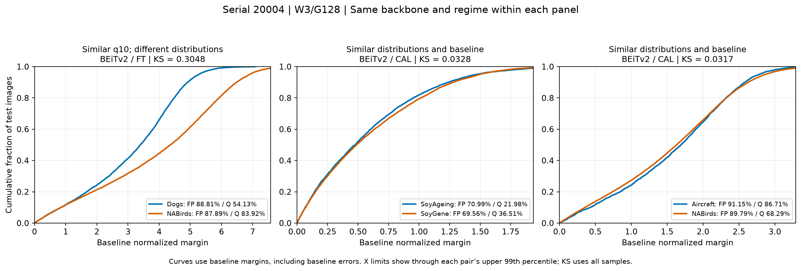

# Baseline／margin 相近但量化 accuracy 不同的實例

Run ID：`20261116_210237_212249_baseline_margin_counterexamples`。開始時間：2026-11-16T21:02:37.212249+08:00，Asia/Taipei。

## 結果

有這些例子。必須區分 baseline accuracy 相近、margin q10 相近，以及完整 margin 經驗分布相近。q10 幾乎相同仍可能有不同的中位數／高 margin 區域，不能據此稱兩個分布相同。

本次僅比較同 backbone、同 regime、同 W3/G128 的 datasets，來源固定為 serial 20004 的既有 144-context 主表與 baseline margins；不混入舊 CAL full-grid。這是跨 dataset/checkpoint 的描述性比較，不是控制 dataset 以外所有因素的因果實驗，也不證明相同 checkpoint weights 或 class counts。

## 資料與驗證

- 重用 `paper_draft/data/20261116_163429_728618_w3_s20004_paper_package/`。
- 主表 144 contexts；九份 `sample_weights.npz` 保存各影像 baseline normalized margin、dataset、baseline correctness。
- 144 contexts 均驗證 sample counts、FP correctness mean、q10 與主表相符；沒有重新 inference 或下載。
- 每個 setting 的 16 datasets 兩兩比較，共 9×120＝1,080 pairs。
- Accuracy 單位 %，差異單位 pp；baseline 是 unquantized AMP-FP16。
- Normalized margin 為 top-1／top-2 class-logit gap 除以全部 class logits 的 population std，分布包含 baseline 答錯的影像。
- KS 距離＝兩個 empirical CDF 的最大絕對差。KS=0.033 表示任一 margin threshold 下，累積比例差最多約 3.3 個百分點。這不是 96.7% 相同、不是 accuracy 差，也不是未拒絕相同分布的檢定結果。
- 同時保存 Wasserstein 距離、baseline-correct 子集的 KS，但主文例子使用所有 test samples 的 empirical CDF。

## 1. Baseline 接近，量化後差很多

探索性條件：FP 差≤0.5 pp、Q 差≥5 pp；共 6 pairs。不是完全相等的 baseline。

| Model / mode | Pair A / B | FP A / B (%) | Q A / B (%) | FP gap (pp) | Q gap (pp) | q10 A / B | KS |
|---|---|---:|---:|---:|---:|---:|---:|
| BEiTv2 / CAL | cars / food | 92.13 / 92.53 | 43.85 / 89.92 | 0.399 | 46.074 | 0.332019 / 2.267843 | 0.88290 |
| BEiTv2 / FT | cars / dogs | 88.87 / 88.81 | 82.63 / 54.13 | 0.058 | 28.501 | 0.483244 / 0.843316 | 0.27043 |
| Swin / CAL | inat17 / soygene | 75.98 / 76.38 | 69.24 / 54.84 | 0.403 | 14.397 | 0.329341 / 0.120414 | 0.47267 |
| Swin / FT | cars / cub | 90.35 / 90.52 | 78.51 / 86.90 | 0.175 | 8.390 | 0.422335 / 0.720502 | 0.40385 |
| BEiTv2 / FZ | cub / food | 90.49 / 90.34 | 23.27 / 15.03 | 0.150 | 8.240 | 0.362480 / 0.311501 | 0.11260 |
| Swin / FT | aircraft / dogs | 87.79 / 87.74 | 76.39 / 81.47 | 0.050 | 5.081 | 0.349693 / 0.505258 | 0.22315 |

## 2. q10 接近，但量化後不同

探索性條件：q10 相對差≤5%（分母取兩者較大值）、Q 差≥10 pp；共 3 pairs。

| Model / mode | Pair A / B | FP A / B (%) | Q A / B (%) | FP gap (pp) | Q gap (pp) | q10 A / B | KS |
|---|---|---:|---:|---:|---:|---:|---:|
| BEiTv2 / FT | dogs / nabirds | 88.81 / 87.89 | 54.13 / 83.92 | 0.925 | 29.794 | 0.843316 / 0.843309 | 0.30484 |
| BEiTv2 / CAL | nabirds / vegfru | 89.79 / 90.39 | 68.29 / 39.06 | 0.597 | 29.238 | 0.356716 / 0.340139 | 0.06473 |
| BEiTv2 / CAL | soyageing / soygene | 70.99 / 69.56 | 21.98 / 36.51 | 1.431 | 14.527 | 0.067628 / 0.070573 | 0.03276 |

Dogs／NABirds 的 q10 幾乎相等，但 KS≈0.305；它們是「低尾分位數相同」的例子，不是「整個分布相近」的例子。Baseline 只差約 0.925 pp，Q accuracy 卻差約 29.794 pp。

## 3. 完整 margin 分布與 baseline 都相近，但量化後不同

探索性條件：KS≤0.05、FP 差≤1.5 pp、Q 差≥10 pp；共 2 pairs。這些 cutoffs 是本次找實例的描述性選擇，沒有事先指定，不能當成 confirmatory test。

| Model / mode | Pair A / B | FP A / B (%) | Q A / B (%) | FP gap (pp) | Q gap (pp) | q10 A / B | KS |
|---|---|---:|---:|---:|---:|---:|---:|
| BEiTv2 / CAL | aircraft / nabirds | 91.15 / 89.79 | 86.71 / 68.29 | 1.355 | 18.414 | 0.430040 / 0.356716 | 0.03173 |
| BEiTv2 / CAL | soyageing / soygene | 70.99 / 69.56 | 21.98 / 36.51 | 1.431 | 14.527 | 0.067628 / 0.070573 | 0.03276 |

同為 BEiTv2/CAL，SoyAgeing／SoyGene 的 baseline 約 71%／70%，q10 與 median 也接近，KS≈0.033，但 Q accuracy 約 22%／37%。Aircraft／NABirds 的 KS≈0.032，Q accuracy 約 87%／68%。

左圖呈現 q10 相近但整個分布不同；中、右圖呈現整體分布相近的實例。X 軸僅顯示至各 pair 的上側第 99 百分位附近，統計量使用未截斷的全部樣本。繪圖僅稀疏顯示曲線，不改變 KS 計算。

## 解讀與限制

這些例子支持：baseline accuracy 或單一 margin summary，皆不能唯一決定量化後 accuracy；甚至完整 baseline margin 的 marginal distribution 相近，也不保證相同的量化結果。

它們不會推翻原表的強 Spearman association，也不能單靠挑出的 pairs 證明 margin 在控制 baseline 後有／沒有額外的泛化預測價值。前者是全體排序趨勢，後者需要事先定義且有適當驗證的 conditional prediction analysis。原先「可能資訊重疊」的解釋仍是假說，不是已證明原因。

量化後是否換預測類別，還取決於各 class logit 的擾動如何與原本的 logit gaps 配合。Margin 分布沒有保存擾動的大小／方向、與 correctness／類別的聯合關係、或量化後由哪些競爭類別越過 winner。Normalized margin 也不直接包含原始 logit std 與 perturbation scale 的全部資訊。

此處分布接近的是所有影像的 marginal distribution，不表示每個類別、FP-correct 子集或每張影像都完全配對。CAL 的 feature／logit view aggregation 差異與 actual quantized module coverage 仍依既有 provenance 限制處理，不將 serial 名稱當作 classifier exclusion 證據。

目前本機 margins 足以做上述分布比較；要分析 margin 相同時為何某些圖片被 damage，需要 matched quantized predictions／logits。不能由 `sample_weights.npz` 單獨重建它們，仍需 server raw exports。

## 保存與重現

完整 pair table、144-context margin summary、選中實例、PNG／PDF 科學圖與來源 hash 均存於 `paper_draft/result/20261116_210237_212249_baseline_margin_counterexamples/`。唯一報告位於本檔，引用 PNG 與 result 對應檔 SHA-256 相同。

Python 使用 `C:/Users/Public/miniconda3/envs/opencode_env/python.exe`；本次核對程式保存於 result 的 `provenance/audit.py`。重現會生成新 run ID，不覆寫本次結果。詳見 `run.json`；本次沒有新增 training、inference 或 full-grid 實驗。
