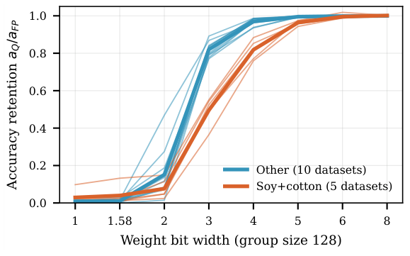
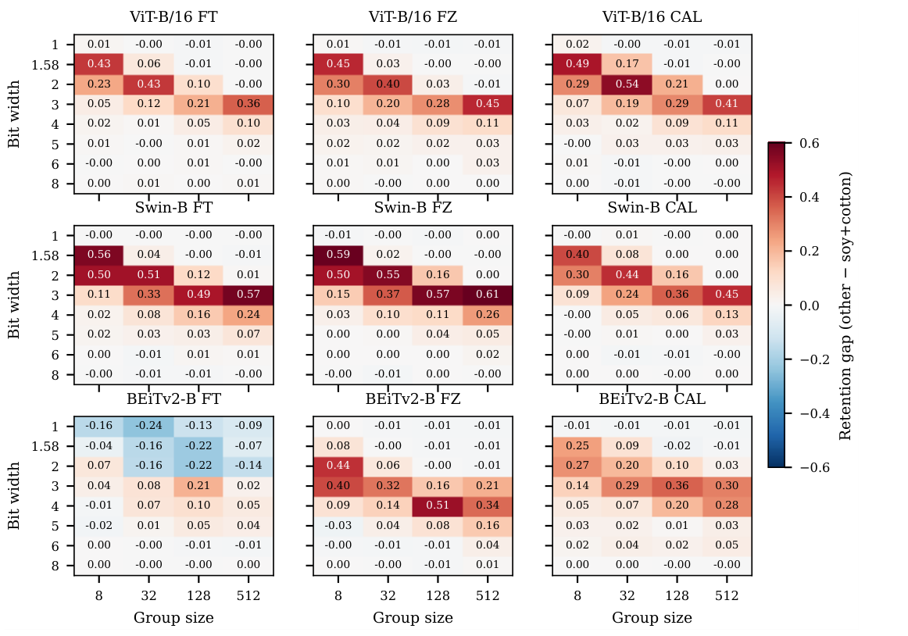
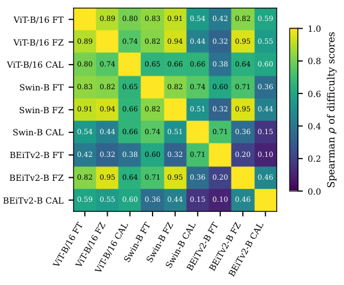
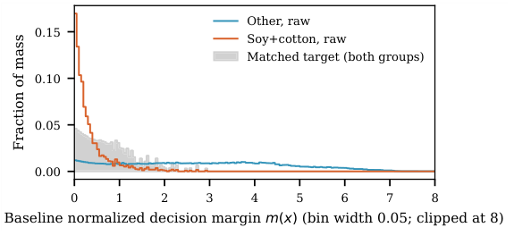
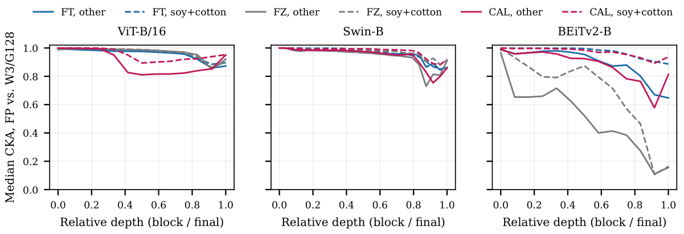
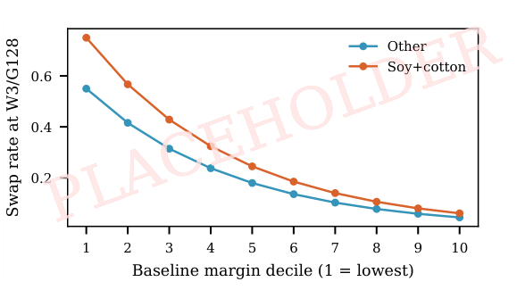

# 僅權重訓練後量化中，依資料集而異的準確率保留率

原題：*Dataset-Dependent Accuracy Retention under Weight-Only Post-Training Quantization*

匿名 WACV 演算法軌投稿；論文編號：`*****`。原稿頁首標示：WACV 2027，Algorithms Track。

> **譯文說明（非原稿內容）**：本文件是先前提供的 7 頁 `short.pdf` 之完整繁體中文翻譯。保留摘要、正文、兩個編號公式、五張表、六張圖及圖說、附錄 A–C，以及全部 26 筆參考文獻。省略重複頁首、頁尾、編輯行號及參考文獻後方的引用頁碼；將跨欄／跨頁的句子接回，浮動圖表依閱讀順序安置。圖內英文保留原貌，另附中文座標與圖例對照。模型、資料集名稱與作者姓名保留原文。
>
> 本次是**忠實翻譯，不是修訂稿**。原稿中的結論、數字、`TBD`、`PLACEHOLDER` 與 Table 3 的 `†` 均保留，不以先前討論的新解釋或數字替換。原稿已知的 CAL protocol、訓練集數量及占位圖等問題，仍須另行修正；詳見 [既有審閱報告](../20261116_201210_623333_short_paper_review/REPORT.md)。譯文中的這段說明及後文明標「譯者註」的文字不屬於原稿。
>
> 翻譯來源：[保存的原稿](C:/project/quant_analysis/paper_draft/data/20261116_201210_623333_short_paper_review/short.pdf)。SHA-256：`4c405d79e1da6c6c99c0967424fbcbc984302a5031023c07d3125e0f8107a9e0`。翻譯日期：2026-11-16，Asia/Taipei；run ID：`20261116_225424_630984_short_zh_tw_translation`。

## 摘要

僅權重訓練後量化（weight-only post-training quantization，PTQ）對某些辨識資料集造成的準確率損失，遠大於其他資料集。我們使用半二次量化（half-quadratic quantization，HQQ），在 16 個細粒度資料集、三種骨幹網路、三種檢查點訓練方式，以及 32 種位元寬度與群組大小的組合上，研究這種資料集相依性。我們透過準確率保留率，也就是量化後準確率與基準準確率的比值，將每個量化模型與其自身的未量化檢查點比較。

位元寬度與群組大小決定保留率的水準。在效能崩潰與完整保留之間的過渡區間中，五個大豆與棉花栽培品種資料集的準確率保留程度，低於其他資料集：使用 3 位元權重、群組大小 128 時，它們保留原準確率的 0.50，而其他資料集為 0.82。資料集的難度排名在不同量化條件間具有一致性，Kendall's (W) 至少為 0.76。

基準 logit 間隔較小的資料集損失較大；匹配兩組的間隔分布後，兩組的保留率差距縮小了 27.6% 至 81.3%。然而，基準準確率對難度的預測能力與間隔相當。基準模型與量化模型之間的特徵相似度，並未與準確率損失呈現相應關係。

## 1. 緒論

訓練後量化（PTQ）不需要完整的訓練階段，就能將已訓練網路轉換為低精度權重 [4]。PTQ 研究大多著重於改進量化器，例如使用更好的校準 [24]、混合精度 [9]，或合成校準資料 [8, 26]，並在少數標準基準資料集上評估。然而，同一個量化器對某個資料集造成的準確率損失，可能遠大於另一個資料集。效能退化會隨醫學影像資料集與骨幹網路 [16]、類別與人口群體 [12]，以及校準分布 [25] 而改變。在樣本層級，量化後的預測變化已被指出與較小的輸出間隔有關 [6]。這些發現顯示，量化穩健性是資料與已訓練模型共同具有的性質，而不只取決於量化器。

**圖 1.** 群組大小為 128 時，準確率保留率隨權重位元寬度的變化，數值對三種骨幹網路及三種檢查點訓練方式取平均。細線代表各資料集，粗線代表群組平均。由於 VegFru 的網格不完整，因此將其排除。

圖內文字對照：橫軸為「權重位元寬度（群組大小 128）」；縱軸為「準確率保留率 (a_Q/a_{mathrm{FP}})」。Other 為「其他組（10 個資料集）」；Soy+cotton 為「大豆＋棉花組（5 個資料集）」。

細粒度影像辨識（fine-grained image recognition，FGIR）讓這種相依性更容易被看見，因為其資料集涵蓋鳥類、汽車，一直到連專家也難以區分的大豆與棉花栽培品種 [23]。圖 1 顯示，僅權重量化對這些資料集的影響並不均等。在 3 位元權重下，五個栽培品種資料集各自最多只保留原準確率的 0.55，而其他每個資料集至少保留 0.77。然而，栽培品種資料集的基準準確率也低得多，因此僅看最終準確率，無法判斷究竟是哪一項資料集性質重要。

因此，我們探討：資料集效應出現在位元寬度與群組大小網格的哪個區域；資料集排名是否在不同模型間維持；以及基準決策間隔能否在基準準確率之外，進一步說明量化難度。

為回答這些問題，我們在完整的僅權重量化條件網格上，將每個量化模型與其自身的未量化檢查點比較 [1]。本研究的貢獻如下：

1. 我們在 32 種條件下，量測 16 個細粒度資料集、三種骨幹網路與三種檢查點訓練方式的準確率保留率，並指出資料集效應位於效能崩潰與完整保留之間的過渡區間。
2. 我們顯示，資料集難度排名在不同量化條件間穩定，但在不同骨幹網路與訓練方式間僅部分穩定。
3. 我們檢驗預先指定的間隔診斷方法，並顯示跨資料集的間隔訊號無法與基準準確率分離。

## 2. 實驗設定

### 資料集與分組

我們使用 16 個分類資料集（見附錄表 3）。其中 11 個 FGIR 資料集涵蓋鳥類、飛機、汽車、狗、花卉、食物、寵物、蔬菜與水果、動漫角色，以及自然物種 [2, 5, 7, 11, 14, 15, 17, 20–22] **[TBD：補上 Moe 的引用]**。其餘五個為超細粒度基準中的四個大豆栽培品種資料集，以及一個棉花栽培品種資料集 [23]。我們將它們稱為「大豆＋棉花組」（soy+cotton），其餘稱為「其他組」（other）。分組依據是資料來源，而非量測得到的性質。對資料集取平均後，大豆＋棉花組的基準 top-1 準確率為 32.5%，其他組為 87.3%。

### 模型與量化

我們使用 ViT-B/16 [3]、Swin-B [13] 與 BEiTv2-B [18]，每個模型都在各資料集上，依三種方式訓練。FT 微調整個網路；FZ 凍結骨幹網路，只訓練分類器；CAL 則使用反事實注意力學習進行微調 [19] **[TBD：確認訓練方式的定義與預訓練權重]**。每一組資料集、骨幹網路與訓練方式構成一個實驗情境（context），共 144 個情境。

HQQ [1] 量化骨幹網路中每個線性層的權重，並讓分類器維持完整精度；活化值不進行量化 **[TBD：HQQ 版本]**。網格涵蓋位元寬度

\[
b\in\{1,1.58,2,3,4,5,6,8\}
\]

以及群組大小

\[
g\in\{8,32,128,512\},
\]

共 32 種條件。當 (b=3)、(g=128) 時，記為 W3/G128。基準模型是在相同測試影像上，以 FP16 混合精度評估同一個檢查點，但不使用 HQQ。網格包含 141 個情境中的 4,490 筆結果；VegFru 缺少 Swin-B 以及大部分 ViT-B/16 CAL 結果，因此網格分析使用 15 個資料完整的資料集。

### 保留率與難度

令基準準確率為 (a_{\mathrm{FP}})，量化後準確率為 (a_Q)，準確率保留率定義為

\[
r=\frac{a_Q}{a_{\mathrm{FP}}},
\]

相對損失則為 (1-r)。群組保留率對組內各資料集給予相同權重；保留率差距定義為其他組的保留率，減去大豆＋棉花組的保留率。主要條件為群組大小 8 與 128 下的 W3、W4；在這些條件下，保留率既未飽和於接近零，也未接近一。

在每個骨幹網路與訓練方式內，資料集的難度分數，是其相對損失的百分位排名在四個主要條件上的平均。Kendall's (W) 用來量測四個條件之間的一致程度；只有在 (W\ge0.6) 時，我們才將該分數視為共同排名。

### 決策間隔

對影像 (x) 的基準 logits (z)，正規化決策間隔定義為

\[
m(x)=\frac{z_{(1)}-z_{(2)}}{\sigma(z)}. \tag{1}
\]

其中，(z_{(1)}) 與 (z_{(2)}) 是最大的兩個 logits，(\sigma(z)) 是所有類別 logits 的標準差。易受影響尾端的間隔 (q_{10})，是某個情境所有測試影像之 (m(x)) 的第 10 百分位數。

我們預先指定 (q_{10}) 為主要間隔預測指標。當它與難度分數之間的 Spearman 相關係數 (\rho\le-0.5)，且單尾資料集置換檢定的 (p<0.05) 時，視為具有難度訊號。這個相關係數還必須在四個主要條件中至少三個為負，且每次排除任一資料集後仍為負。我們進一步檢驗：將 (q_{10}) 加入預先指定的控制變項，也就是基準準確率及類別數的對數後，是否能降低難度分數線性模型的留一資料集交叉驗證誤差。

### W3/G128 的間隔匹配

為探討差距有多少來自不同的間隔分布，我們對兩組測試影像重新加權，使其符合共同的間隔分布。我們使用寬度為 0.05 的分箱，並在各組內對資料集給予相同權重；目標分布取兩組直方圖在每個分箱中的較小值。此時，群組保留率改為加權量化準確率除以加權基準準確率。我們在呈現匹配後差距時，也報告直方圖重疊程度與有效樣本數（effective sample size，ESS）。W3/G128 的特徵與決策診斷定義於附錄 B。

## 3. 結果

### 資料集效應出現在哪裡？

如果資料集之間僅存在雜訊差異，保留率差距應該會在整個網格中圍繞零散布。實際上，位元寬度與群組大小決定了保留率的水準，而差距集中在保留率介於兩個極限之間的區域（圖 2）。對九組骨幹網路與訓練方式取平均後，在任何群組大小下，1 位元時的保留率最多為 0.024，8 位元時則至少為 0.999。

在 W3/G128，大豆＋棉花組的保留率為 0.50，其他組為 0.82，差距為 0.32。在 3 位元下，九組設定與四種群組大小形成的 36 種組合，差距全部為正；在 4 位元下，36 種組合中有 34 種為正。較小的群組會使這個區間移向較低位元：W2/G8 的差距為 0.32，但 W2/G128 僅為 0.07，此時平均保留率已降至 0.13。因此，資料集效應是過渡區間中的性質，而該區間由位元寬度與群組大小共同決定。

在 1 位元下，BEiTv2 FT 的差距為負，因為其大豆＋棉花組中有數個基準模型的表現接近隨機猜測；共有七個情境的基準 top-1 準確率低於 15%，且全都屬於大豆＋棉花組。

**圖 2.** 各骨幹網路與訓練方式下，保留率差距（其他組－大豆＋棉花組）隨位元寬度與群組大小的變化。正值表示大豆＋棉花資料集的保留率較低。群組平均對 15 個資料完整的資料集給予相同權重；VegFru 不包含在內。

圖內文字對照：橫軸為「群組大小」，縱軸為「位元寬度」，色階為「保留率差距（其他組－大豆＋棉花組）」。九個子圖的模型與訓練方式標記保留原文，所有格內數值沿用原圖。

### 資料集排名穩定嗎？

若某項資料集性質主導量化難度，它應該在不同條件與模型下，對資料集給出相似排名。在每一組設定內，四個主要條件具有良好一致性，Kendall's (W) 介於 0.76 與 0.96（表 1）。跨設定的一致性較弱：任兩組設定難度分數的 Spearman 相關係數，其中位數為 0.62，範圍為 0.10 至 0.95（圖 3）。BEiTv2 CAL 與 BEiTv2 FT 的一致程度最低，因此僅由骨幹網路本身，無法決定排名。儘管如此，在每一組設定中，難度最高的五個位置，至少有三個由大豆＋棉花資料集占據。

### 基準間隔能說明難度嗎？

如果量化對各處 logits 的擾動幅度相近，含有大量小間隔影像的資料集，理應損失更多。預先指定的間隔訊號在九組設定中的八組成立，(\rho) 的中位數為 −0.86，而且九組的 (p) 值皆小於 0.05（表 1）。BEiTv2 FT 只有相關強度未達標準，其 (\rho=-0.48)。然而，基準準確率與難度分數的相關程度幾乎同樣強，(\rho) 的中位數為 −0.83。將 (q_{10}) 加入控制變項後，只有九組中的三組降低了留出預測誤差。間隔訊號確實存在，但跨資料集而言，無法將它與基準準確率分離。

**表 1.** 15 個資料完整資料集的難度分數。(W)：四個主要條件的一致程度。(\rho)：難度分數與基準間隔 (q_{10}) 的 Spearman 相關係數（(p) 為單尾置換檢定），以及與 FP top-1 的相關係數。Err：僅使用控制變項（Ctrl.），以及加入 (q_{10}) 後的留一資料集平方誤差，數值乘以 (10^3)。箭頭 ↑／↓ 分別表示較高／較低較佳。

| 骨幹網路 | 訓練方式 | (W\uparrow) | 間隔 (q_{10})：(\rho) | 間隔 (q_{10})：(p) | FP top-1：(\rho) | 誤差 ↓：Ctrl. | 誤差 ↓：+(q_{10}) |
|---|---|---:|---:|---:|---:|---:|---:|
| ViT-B/16 | FT | 0.89 | −0.98 | <0.01 | −0.97 | 16.3 | 62.5 |
| ViT-B/16 | FZ | 0.93 | −0.92 | <0.01 | −0.90 | 15.9 | 184.8 |
| ViT-B/16 | CAL | 0.80 | −0.83 | <0.01 | −0.83 | 21.8 | 21.7 |
| Swin-B | FT | 0.81 | −0.86 | <0.01 | −0.78 | 37.2 | 74.5 |
| Swin-B | FZ | 0.96 | −0.97 | <0.01 | −0.98 | 11.9 | 164.4 |
| Swin-B | CAL | 0.76 | −0.63 | <0.01 | −0.59 | 73.8 | 84.7 |
| BEiTv2-B | FT | 0.83 | −0.48 | 0.04 | −0.40 | 120.1 | 111.8 |
| BEiTv2-B | FZ | 0.93 | −0.92 | <0.01 | −0.95 | 11.1 | 86.1 |
| BEiTv2-B | CAL | 0.94 | −0.83 | <0.01 | −0.74 | 49.5 | 32.5 |

間隔匹配在 W3/G128 的測試影像內提出相同問題；大豆＋棉花組影像的間隔集中於較小的範圍（圖 4）。將兩組匹配至共同間隔分布後，差距縮小了 27.6% 至 81.3%（表 2）。九組設定的匹配後差距皆維持正值，因此即使在相同間隔下，大豆＋棉花組的影像仍損失較多。這項比較僅涵蓋直方圖中 0.19 至 0.40 的共同質量，而匹配後 ESS 最低降至原始 ESS 的 20.8%。

**表 2.** W3/G128 下，匹配基準間隔分布前後的保留率差距（其他組－大豆＋棉花組），分箱寬度為 0.05。Red. 為差距縮減比例。Overlap 為直方圖的共同質量；ESS 為兩組中較低的「匹配後／原始」有效樣本數比值。

| 骨幹網路 | 訓練方式 | 原始差距 | 匹配後差距 | 縮減比例（%） | 重疊質量 | ESS（%） |
|---|---|---:|---:|---:|---:|---:|
| ViT-B/16 | FT | 0.212 | 0.042 | 80.0 | 0.26 | 23.4 |
| ViT-B/16 | FZ | 0.310 | 0.188 | 39.2 | 0.40 | 42.6 |
| ViT-B/16 | CAL | 0.268 | 0.118 | 55.9 | 0.24 | 29.6 |
| Swin-B | FT | 0.498 | 0.248 | 50.2 | 0.23 | 26.3 |
| Swin-B | FZ | 0.569 | 0.412 | 27.6 | 0.34 | 32.9 |
| Swin-B | CAL | 0.341 | 0.112 | 67.1 | 0.26 | 31.9 |
| BEiTv2-B | FT | 0.408 | 0.188 | 53.9 | 0.19 | 20.9 |
| BEiTv2-B | FZ | 0.184 | 0.078 | 57.4 | 0.37 | 34.1 |
| BEiTv2-B | CAL | 0.325 | 0.061 | 81.3 | 0.34 | 47.5 |

### 特徵與決策的變化能說明這些結果嗎？

困難資料集的量化特徵，並沒有比其他資料集更偏離基準。在中間深度，基準與 W3/G128 特徵之間的 CKA 中位數，大豆＋棉花組為 0.99，其他組為 0.97（圖 5）；最終層 CKA 與難度分數的相關係數，其 (\rho) 中位數僅為 −0.28（表 5）。

特徵相似度能標示出一組發生效能崩潰的設定，也就是 BEiTv2 FZ；其最終 CKA 中位數為 0.16，平均準確率從 62.9% 降至 12.3%（表 4）。在決策層級，每一組設定中，損害（damage）至少是救回（rescue）的 2.8 倍。交叉擬合的類別偏移校正，能恢復 0.6 至 11.3 個百分點的 top-1 準確率，而隨機打亂類別的對照組則損失 0.9 至 7.7 個百分點，因此部分損害來自類別特定的 logit 偏移。在九組設定中的七組，競爭類別的數量能在間隔之外，進一步改善損害預測。

## 4. 結論

本文量測僅權重 HQQ 量化，在 16 個細粒度資料集、三種骨幹網路與三種檢查點訓練方式中，造成多少準確率損失。位元寬度與群組大小決定保留率水準，而資料集之間只在過渡區間呈現差異；在這個區間中，大豆與棉花栽培品種資料集持續損失較多。

較小的基準間隔伴隨較大的損失，而匹配間隔能縮小差距，但無法消除差距。由於基準準確率對難度的預測能力與間隔相當，要分離兩者，需要一些在其中一項有差異、但另一項沒有差異的資料集。每個資料集都與其訓練後的檢查點綁定，每個情境只有一個檢查點與一個推論種子，因此這些差異是關聯，而非資料本身的單獨效應。

## 參考文獻

> 譯者註：以下保留原稿的編號、作者、年份、出版處、頁碼與 arXiv 識別碼，翻譯文獻標題與出版處名稱。原稿不完整的作者欄亦照錄，未自行補齊。每筆原稿末尾的「本論文引用頁碼」不重複列出。

[1] Hicham Badri 與 Appu Shaji。〈大型機器學習模型的半二次量化〉。https://mobiusml.github.io/hqq_blog/，2023。

[2] Lukas Bossard、Matthieu Guillaumin 與 Luc Van Gool。〈Food-101：利用隨機森林探勘具有判別力的組件〉。歐洲電腦視覺會議（ECCV），頁 446–461，2014。

[3] Alexey Dosovitskiy、Lucas Beyer、Alexander Kolesnikov、Dirk Weissenborn、Xiaohua Zhai、Thomas Unterthiner、Mostafa Dehghani、Matthias Minderer、Georg Heigold、Sylvain Gelly、Jakob Uszkoreit 與 Neil Houlsby。〈一張影像相當於 16×16 個詞：用於大規模影像辨識的 Transformer〉。國際學習表徵會議（ICLR），2021。

[4] Amir Gholami、Sehoon Kim、Zhen Dong、Zhewei Yao、Michael W. Mahoney 與 Kurt Keutzer。〈用於高效率神經網路推論的量化方法綜述〉。收錄於《低功耗電腦視覺》（*Low-Power Computer Vision*），頁 291–326，Chapman and Hall/CRC，2022。

[5] Saihui Hou、Yushan Feng 與 Zilei Wang。〈VegFru：用於細粒度視覺分類的特定領域資料集〉。IEEE 國際電腦視覺會議（ICCV），頁 541–549，2017。

[6] Qiang Hu、Yuejun Guo、Maxime Cordy、Xiaofei Xie、Wei Ma、Mike Papadakis 與 Yves Le Traon。〈朝向理解模型量化，以實現可靠的深度神經網路部署〉。IEEE/ACM 國際 AI 工程會議（CAIN），頁 56–67，2023。

[7] Aditya Khosla、Nityananda Jayadevaprakash、Bangpeng Yao 與 Li Fei-Fei。〈用於細粒度影像分類的新資料集：Stanford Dogs〉。CVPR 細粒度視覺分類工作坊，2011。

[8] Minjun Kim、Jongjin Kim 與 U Kang。〈SynQ：透過合成感知微調實現精確的零樣本量化〉。國際學習表徵會議（ICLR），2025。

[9] Minjun Kim 等人。〈LampQ：朝向精確的 Vision Transformer 逐層混合精度量化〉。AAAI 人工智慧會議，2026。

[10] Simon Kornblith、Mohammad Norouzi、Honglak Lee 與 Geoffrey Hinton。〈重新探討神經網路表徵的相似度〉。國際機器學習會議（ICML），頁 3519–3529，2019。

[11] Jonathan Krause、Michael Stark、Jia Deng 與 Li Fei-Fei。〈用於細粒度分類的三維物體表徵〉。IEEE 國際電腦視覺會議工作坊，頁 554–561，2013。

[12] Liu 等人。〈理解網路量化中的不公平性〉。國際機器學習會議（ICML），2025。

[13] Ze Liu、Yutong Lin、Yue Cao、Han Hu、Yixuan Wei、Zheng Zhang、Stephen Lin 與 Baining Guo。〈Swin Transformer：使用位移視窗的階層式 Vision Transformer〉。IEEE/CVF 國際電腦視覺會議（ICCV），頁 10012–10022，2021。

[14] Subhransu Maji、Esa Rahtu、Juho Kannala、Matthew Blaschko 與 Andrea Vedaldi。〈飛機的細粒度視覺分類〉。arXiv 預印本，arXiv:1306.5151，2013。

[15] Maria-Elena Nilsback 與 Andrew Zisserman。〈大量類別下的自動花卉分類〉。印度電腦視覺、圖形與影像處理會議，頁 722–729，2008。

[16] Ozdemir 與 Li。〈彌合可靠性落差：INT8 量化對醫學影像判別與校準的影響〉。健康、推論與學習會議（CHIL），2026。

[17] Omkar M. Parkhi、Andrea Vedaldi、Andrew Zisserman 與 C. V. Jawahar。〈貓與狗〉。IEEE 電腦視覺與模式辨識會議（CVPR），頁 3498–3505，2012。

[18] Zhiliang Peng、Li Dong、Hangbo Bao、Qixiang Ye 與 Furu Wei。〈BEiT v2：使用向量量化視覺 tokenizer 的遮罩影像建模〉。arXiv 預印本，arXiv:2208.06366，2022。

[19] Yongming Rao、Guangyi Chen、Jiwen Lu 與 Jie Zhou。〈用於細粒度視覺分類與重新識別的反事實注意力學習〉。IEEE/CVF 國際電腦視覺會議（ICCV），頁 1025–1034，2021。

[20] Grant Van Horn、Steve Branson、Ryan Farrell、Scott Haber、Jessie Barry、Panos Ipeirotis、Pietro Perona 與 Serge Belongie。〈與公民科學家共同建立鳥類辨識應用程式與大規模資料集：細粒度資料集蒐集中的細節〉。IEEE 電腦視覺與模式辨識會議（CVPR），頁 595–604，2015。

[21] Grant Van Horn、Oisin Mac Aodha、Yang Song、Yin Cui、Chen Sun、Alex Shepard、Hartwig Adam、Pietro Perona 與 Serge Belongie。〈iNaturalist 物種分類與偵測資料集〉。IEEE 電腦視覺與模式辨識會議（CVPR），頁 8769–8778，2018。

[22] Catherine Wah、Steve Branson、Peter Welinder、Pietro Perona 與 Serge Belongie。〈Caltech-UCSD Birds-200-2011 資料集〉。技術報告 CNS-TR-2011-001，加州理工學院，2011。

[23] Xiaohan Yu、Yang Zhao、Yongsheng Gao、Xiaohui Yuan 與 Shengwu Xiong。〈超越人類表現的超細粒度視覺分類基準平台〉。IEEE/CVF 國際電腦視覺會議（ICCV），頁 10285–10295，2021。

[24] Zhihang Yuan、Chenhao Xue、Yiqi Chen、Qiang Wu 與 Guangyu Sun。〈PTQ4ViT：使用雙均勻量化的 Vision Transformer 訓練後量化〉。歐洲電腦視覺會議（ECCV），頁 191–207，2022。

[25] Zhihang Yuan、Jiawei Liu、Jiaxiang Wu、Dawei Yang、Qiang Wu、Guangyu Sun、Wenyu Liu、Xinggang Wang 與 Bingzhe Wu。〈訓練後量化可靠性的基準評估：特別關注最差情況表現〉。arXiv 預印本，arXiv:2303.13003，2023。

[26] Yunshan Zhong、Mingbao Lin、Mengzhao Chen、Ke Li、Yunhang Shen、Fei Chao、Yongjian Wu 與 Rongrong Ji。〈用於訓練後量化的細粒度資料分布對齊〉。歐洲電腦視覺會議（ECCV），頁 70–86，2022。

## 附錄 A. 資料集

**表 3.** 各資料集、所屬群組、資料切分大小與類別數 (C)。FP 為 AMP FP16 基準下的 top-1 準確率，數值是九組模型與訓練方式設定的平均。

| 資料集 | 群組 | 訓練樣本數 (N) | 測試樣本數 (N) | 類別數 (C) | FP（%） |
|---|---|---:|---:|---:|---:|
| Aircraft | 其他組 | 1,000† | 3,333 | 100 | 78.4 |
| Cars | 其他組 | 1,037† | 8,041 | 196 | 82.7 |
| CUB | 其他組 | 1,074† | 5,794 | 200 | 89.1 |
| Dogs | 其他組 | 1,111† | 8,580 | 120 | 88.5 |
| Flowers | 其他組 | 1,148† | 6,149 | 102 | 98.8 |
| Food | 其他組 | 1,185† | 25,250 | 101 | 90.4 |
| iNat17 | 其他組 | 1,222† | 95,986 | 5,089 | 68.7 |
| Moe | 其他組 | 1,259† | 2,943 | 173 | 91.4 |
| NABirds | 其他組 | 1,296† | 24,633 | 555 | 86.7 |
| Pets | 其他組 | 1,333† | 3,669 | 37 | 92.3 |
| VegFru | 其他組 | 1,370† | 116,931 | 292 | 93.2 |
| SoyAgeing | 大豆＋棉花組 | 1,407† | 4,950 | 198 | 44.2 |
| SoyGene | 大豆＋棉花組 | 1,444† | 11,143 | 1,110 | 37.8 |
| SoyGlobal | 大豆＋棉花組 | 1,481† | 5,814 | 1,938 | 20.4 |
| SoyLocal | 大豆＋棉花組 | 1,518† | 600 | 200 | 27.1 |
| Cotton | 大豆＋棉花組 | 1,555† | 240 | 80 | 32.8 |

> **譯者註（非原稿內容）**：訓練樣本數與 `†` 完全依原稿保留。原稿沒有提供 `†` 的對應註腳；這些訓練數量先前已被標記為需核對的占位內容，不能將此譯表視為已驗證的 training split。

測試影像先縮放至 300 像素，再進行 224 像素的中心裁切；每個情境以一個推論種子評估。在網格中，VegFru 沒有 Swin-B 結果，ViT-B/16 CAL 的 32 種條件也只有 10 種有結果。CAL 預測會聚合裁切與翻轉後的多個視圖，但其特徵來自單張測試影像。

## 附錄 B. 特徵與決策診斷

在 W3/G128，我們對全部 144 個情境，匯出基準與量化模型在每個區塊之後的特徵，以及最終 logits。預測交換（swap）是指影像的預測類別在量化後改變。損害（damage）是由答對變成答錯的交換；救回（rescue）則是由答錯變成答對的交換；兩者皆以全部測試影像為分母計算比例。圖 6 呈現交換率與每張影像基準間隔的關係。

逐層相似度以線性 CKA [10] 量測，對象為經中心化的基準特徵 (X) 與量化特徵 (Y)：

\[
\operatorname{CKA}(X,Y)=
\frac{\left\|X^{\top}Y\right\|_F^2}
{\left\|X^{\top}X\right\|_F\left\|Y^{\top}Y\right\|_F}.
\tag{2}
\]

對經 (\ell_2) 正規化的最終特徵，(D_{\mathrm{intra}}) 為同一類別影像間的平均餘弦距離，(D_{\mathrm{inter}}) 為兩個不同類別影像間的平均餘弦距離，兩者皆採類別等權平均。可分性定義為 (D_{\mathrm{inter}}-D_{\mathrm{intra}})。H-score 為

\[
\operatorname{tr}\left(S_b(S_w+\lambda I)^{-1}\right),
\]

其中 (S_b) 與 (S_w) 分別為類間與類內散布矩陣，特徵維度為 (D)，且

\[
\lambda=0.01\,\operatorname{tr}(S_w)/D.
\]

類別偏移校正使用分層五折切分中的四折，估計各類別在逐列中心化後的平均 logit 變化，再於留出的一折中減去該偏移。五個對照組執行相同校正，但將偏移量對應的類別指派隨機打亂。這項校正使用測試 logits，屬於診斷方法，而非可部署的方法。

競爭類別特徵會計算：其基準 logit 與最高分者相差不超過 0.25、0.5 與 1.0 個 logit 標準差的類別數。兩個邏輯斯迴歸模型在基準答對的影像中預測損害：第一個使用 (m(x)) 的非線性基底與類別數的對數；第二個再加入上述計數。兩者皆使用 (C=100) 的 L2 正則化，並在每個骨幹網路與訓練方式內，以留一資料集方式評估 Brier 分數。在 1,152 次評估中，有八次的 AUROC 無法定義，因為留出集中所有基準答對影像都受到損害；我們將它們回報為缺失值。

## 附錄 C. 補充結果

**圖 3.** 在任兩組骨幹網路與訓練方式設定間，15 個資料完整資料集的難度分數之 Spearman 相關係數。

圖內文字對照：兩軸均列出骨幹網路／訓練方式；色階為「難度分數的 Spearman (\rho)」。模型與 FT／FZ／CAL 標記、矩陣中的數字保留原圖。

**圖 4.** ViT-B/16 FT 下，兩組在匹配前的基準間隔分布，以及匹配所使用的共同目標分布。圖中未顯示大於 8 的間隔。

圖內文字對照：橫軸為「基準正規化決策間隔 (m(x))（分箱寬度 0.05；顯示範圍截至 8）」；縱軸為「質量占比」。Other, raw＝「其他組，原始分布」；Soy+cotton, raw＝「大豆＋棉花組，原始分布」；Matched target (both groups)＝「匹配目標（兩組共用）」。

完整網格與配對的 W3/G128 匯出資料，來自對相同檢查點分別執行的評估。在兩者共同具備的 140 個情境中，基準 top-1 準確率最多相差 0.17 個百分點，W3/G128 top-1 準確率最多相差 0.50 個百分點。

**圖 5.** 每個區塊之後，基準與 W3/G128 特徵之間的線性 CKA，對各群組資料集取中位數。深度是區塊索引除以位置總數；Swin-B 有 25 個位置，其餘模型有 13 個。正文所稱的中間深度，彙集了相對深度 0.45 至 0.55 之間的所有情境。

圖內文字對照：橫軸為「相對深度（區塊／最終位置）」；縱軸為「CKA 中位數：FP 與 W3/G128」。三個子圖分別是 ViT-B/16、Swin-B、BEiTv2-B。圖例 FT/FZ/CAL, other 代表該訓練方式的「其他組」；FT/FZ/CAL, soy+cotton 代表該訓練方式的「大豆＋棉花組」。

**表 4.** 各骨幹網路與訓練方式在 16 個資料集上的 W3/G128 結果。準確率、交換率、損害率與救回率，皆為對資料集取平均後的百分比；相對損失與最終層 CKA 則為資料集的中位數。Bias gain 為交叉擬合類別偏移校正後的平均 top-1 變化，旁列五個隨機打亂類別對照組的平均值。(\Delta\mathrm{Brier})（數值乘以 (10^3)）為加入競爭類別特徵後，以留一資料集方式評估之損害 Brier 分數變化；負值較佳。

| 骨幹網路 | 訓練方式 | FP（%） | Q（%） | 相對損失（%）↓ | CKA ↑ | 交換率 | 損害率 | 救回率 | 偏移校正增益 | 打亂對照 | ΔBrier ↓ |
|---|---|---:|---:|---:|---:|---:|---:|---:|---:|---:|---:|
| ViT-B/16 | FT | 70.7 | 65.5 | 6.1 | 0.88 | 25.8 | 8.1 | 2.9 | 0.64 | −0.94 | 3.71 |
| ViT-B/16 | FZ | 62.8 | 56.1 | 8.5 | 0.91 | 35.0 | 9.9 | 3.2 | 1.52 | −1.55 | −4.58 |
| ViT-B/16 | CAL | 72.0 | 67.3 | 3.5 | 0.95 | 25.5 | 7.4 | 2.7 | 1.29 | −1.13 | −6.07 |
| Swin-B | FT | 72.5 | 62.6 | 9.3 | 0.87 | 32.8 | 12.1 | 2.2 | 1.91 | −1.47 | −2.34 |
| Swin-B | FZ | 69.6 | 59.5 | 10.6 | 0.91 | 34.8 | 12.7 | 2.6 | 4.15 | −2.34 | −9.32 |
| Swin-B | CAL | 79.3 | 70.7 | 5.1 | 0.90 | 23.6 | 10.6 | 2.1 | 2.47 | −1.60 | −2.22 |
| BEiTv2-B | FT | 65.0 | 50.4 | 25.7 | 0.78 | 38.4 | 16.3 | 1.7 | 2.78 | −0.93 | 0.01 |
| BEiTv2-B | FZ | 62.9 | 12.3 | 89.4 | 0.16 | 87.5 | 51.2 | 0.6 | 2.06 | −1.19 | −0.19 |
| BEiTv2-B | CAL | 76.4 | 50.1 | 44.8 | 0.86 | 46.6 | 28.0 | 1.8 | 11.31 | −7.72 | −2.39 |

**表 5.** 15 個資料完整資料集上，各項性質與難度分數的 Spearman 相關係數。FP：基準 top-1。Sep.：可分性。H：H-score。Norm：特徵範數比值 P99/P50。除了基準與 W3/G128 特徵之間的最終層 CKA，其餘指標皆在基準模型上量測。

| 骨幹網路 | 訓練方式 | (q_{10}) | FP | (C) | Sep. | H | Norm | CKA |
|---|---|---:|---:|---:|---:|---:|---:|---:|
| ViT-B/16 | FT | −0.98 | −0.97 | 0.52 | −0.84 | −0.32 | 0.42 | −0.28 |
| ViT-B/16 | FZ | −0.92 | −0.90 | 0.37 | −0.83 | −0.24 | −0.90 | −0.55 |
| ViT-B/16 | CAL | −0.83 | −0.83 | 0.48 | 0.06 | −0.03 | 0.41 | −0.07 |
| Swin-B | FT | −0.86 | −0.78 | 0.55 | −0.73 | −0.58 | −0.37 | −0.60 |
| Swin-B | FZ | −0.97 | −0.98 | 0.44 | −0.81 | −0.15 | −0.80 | −0.33 |
| Swin-B | CAL | −0.63 | −0.59 | 0.44 | 0.07 | −0.51 | −0.11 | −0.18 |
| BEiTv2-B | FT | −0.48 | −0.40 | 0.07 | −0.39 | −0.21 | −0.16 | −0.36 |
| BEiTv2-B | FZ | −0.92 | −0.95 | 0.36 | −0.88 | −0.43 | 0.70 | −0.11 |
| BEiTv2-B | CAL | −0.83 | −0.74 | 0.16 | 0.30 | −0.06 | −0.08 | 0.28 |

**圖 6. [PLACEHOLDER：合成數值]** 在各資料集內，依基準間隔的十分位分箱呈現 W3/G128 的交換率，再對資料集等權平均 **[TBD：需要逐影像的量化後預測]**。

圖內文字對照：橫軸為「基準間隔十分位分箱（1＝最低）」；縱軸為「W3/G128 的交換率」。Other＝「其他組」；Soy+cotton＝「大豆＋棉花組」；PLACEHOLDER＝「占位圖」。

使用 0.025、0.05 與 0.1 的匹配分箱寬度時，保留率差距的縮減範圍為 27.5% 至 81.3%。

---

## 譯文核對與保存資訊（非原稿內容）

- 範圍：摘要、正文第 1–4 節、附錄 A–C、表 1–5、圖 1–6、公式 (1)–(2)、參考文獻 [1]–[26]。
- 原圖取自相同來源 PDF，僅裁出圖形區域；沒有修改曲線、熱圖數值或移除 Figure 6 的占位標示。中文圖說及圖內文字對照另列於正文。
- 表格數值依原稿逐項保留，包括訓練樣本數占位欄、20.8% 與 20.9% 等原稿既有差異。未將先前核對得到的新值或修訂意見混入譯文。
- PDF 文字擷取、原圖裁切座標、來源與產物 hashes、表格數值核對及完成狀態，保存於 `paper_draft/result/20261116_225424_630984_short_zh_tw_translation/`。
- 本次只新增譯文與原圖擷取產物，未修改英文原稿，未執行實驗、下載新資料或更新文獻事實。
