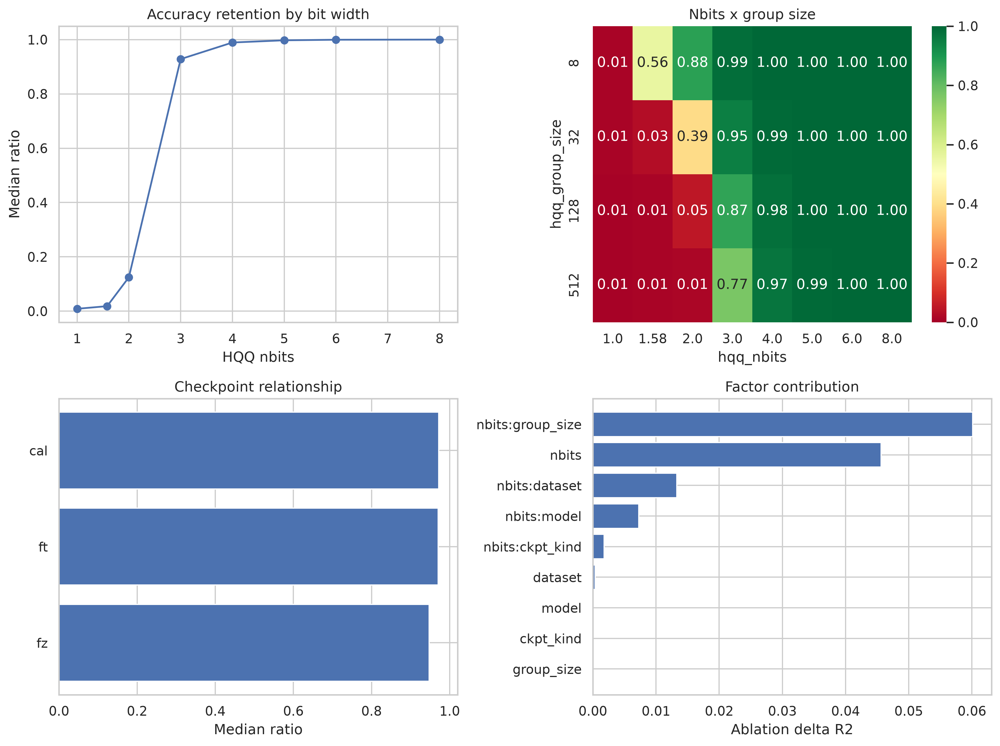
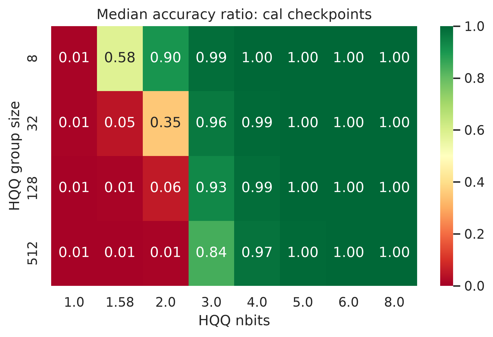
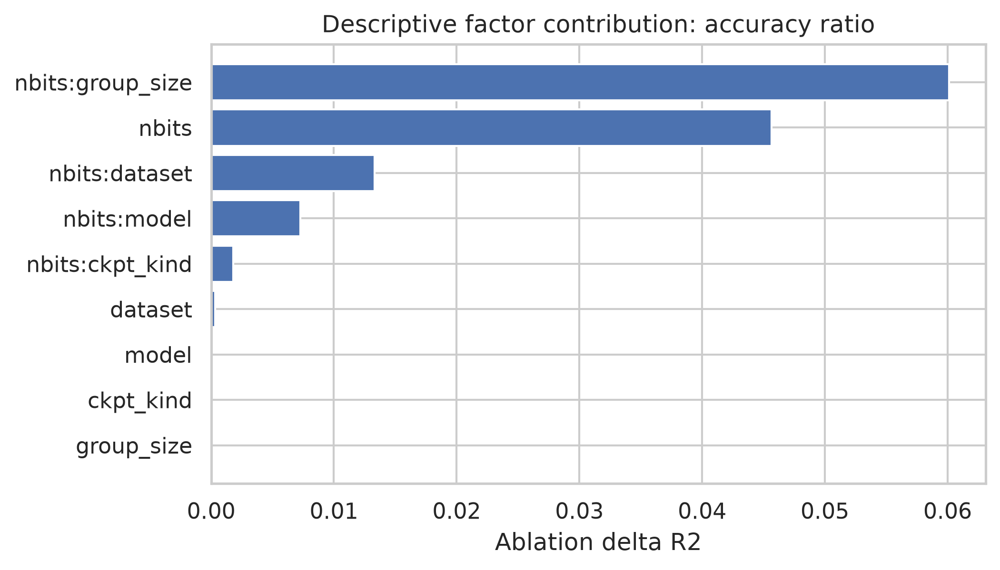

# Legacy HQQ accuracy analysis — 10000–10016

- Run: `20261120_recheck_s10000_10016`; status: complete.
- Time: 2026-11-20T13:19:51.607793+08:00 → 2026-11-20T13:20:30.816435+08:00 (Asia/Taipei).
- Input: `/mnt/ssd2tb/edwin/analysis/quant_analysis/.claude/worktrees/restructure/legacy/quant_acc/data/20261120_131258_wandb_s10000_10016`; W&B `nycu_pcs/TiT`; 6,512 downloaded runs.
- Source manifest SHA-256: `c75a41b8ef6c1a9d77b466822dc6729ecdbf78026b2e3b8e266c163f4cda285d`.
- Git: `05cb197e9127c25905981efd2b28230d57e66a76`; dirty=True.

## Method and pairing

All 16 datasets, including cotton; 3 models × FT/FZ/CAL × 8 bit widths × 4 group sizes. CAL baseline and HQQ results use serial 10016 only. FT/FZ use the newest finished positive AMP baseline per dataset/model/mode, then the newest compatible HQQ run for each bit/group condition. Older duplicates are not averaged. Checkpoint path aliases use the existing explicit ../../data/ → /work/kyle0724/data/ rule.

Pairing checks complete checkpoint path, model, dataset, mode, seed, classifier, AMP precision, resize/crop/evaluation settings and dataset root; all decisions and missing optional fields are saved in audit/pair_audit.csv. The baseline is unquantized AMP; fp32_top1 is a legacy column name. Accuracy ratio = HQQ top-1 / matched unquantized AMP top-1. Factor models and plots reuse the existing quant_acc stages and formulas.

## Results and validation

- 4,608 matched HQQ cells; 144 baselines; 144/144 complete contexts; missing conditions: 0.
- 1,584 selected CAL runs exclusively from 10016.
- Formula and selected run-ID uniqueness checks passed; 16 dataset XLSX workbooks; 29 PNG figures; report figure hashes match the full outputs.

| Mode | Cells | Median accuracy ratio |
|---|---:|---:|
| cal | 1536 | 0.971937 |
| ft | 1536 | 0.970183 |
| fz | 1536 | 0.947415 |





## Descriptive factor contributions

| Term | Ablation delta R² |
|---|---:|
| nbits:group_size | 0.060105 |
| nbits | 0.045639 |
| nbits:dataset | 0.013302 |
| nbits:model | 0.007265 |
| nbits:ckpt_kind | 0.001795 |
| dataset | 0.000346 |
| model | 0.000035 |
| ckpt_kind | 0.000034 |
| group_size | 0.000009 |



## Limitations

Checkpoint bytes were not downloaded or independently hashed; matching paths/configuration do not prove byte-identical weights. A single recorded seed does not establish uncertainty across retraining. CAL 10016 excludes DFSM classifiers and leaves quantization scale/zero metadata unquantized. FT/FZ retain their recorded per-context settings, including heterogeneous metadata-quantization settings; CAL versus FT/FZ and dataset/model effects are descriptive and confounded. Batch-size mismatches and optional unrecorded evaluation fields remain visible in the pair audit. No server inference or causal comparison was performed.

## Reproduce

```powershell
conda run -n opencode_env python -m quant_acc.rerun_serial_grid --input-dir /mnt/ssd2tb/edwin/analysis/quant_analysis/.claude/worktrees/restructure/legacy/quant_acc/data/20261120_131258_wandb_s10000_10016 --run-id 20261120_recheck_s10000_10016
```

Complete outputs: `/mnt/ssd2tb/edwin/analysis/quant_analysis/.claude/worktrees/restructure/legacy/quant_acc/result/20261120_recheck_s10000_10016`. Input hashes, commands, source snapshots, output hashes and validation are in `run.json`. Existing input and result directories are never overwritten. The input snapshot includes acquisition code and its manifest; a new download requires a new input ID.
