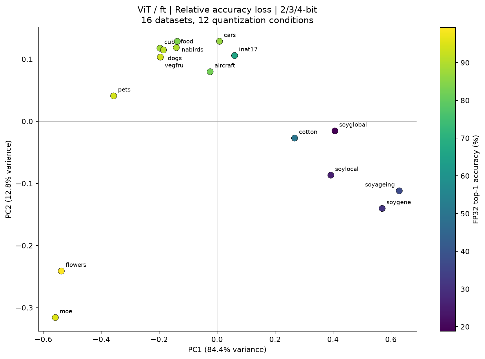
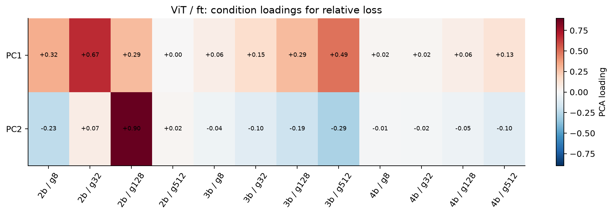
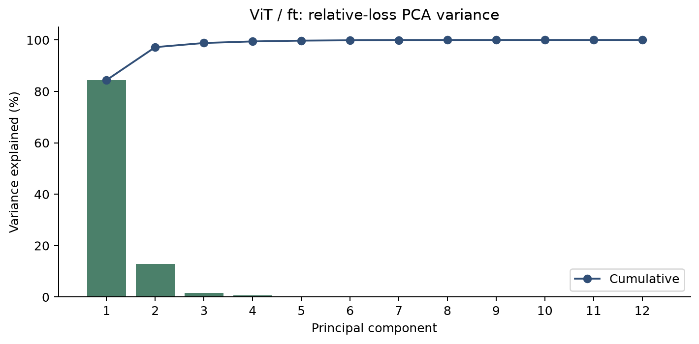
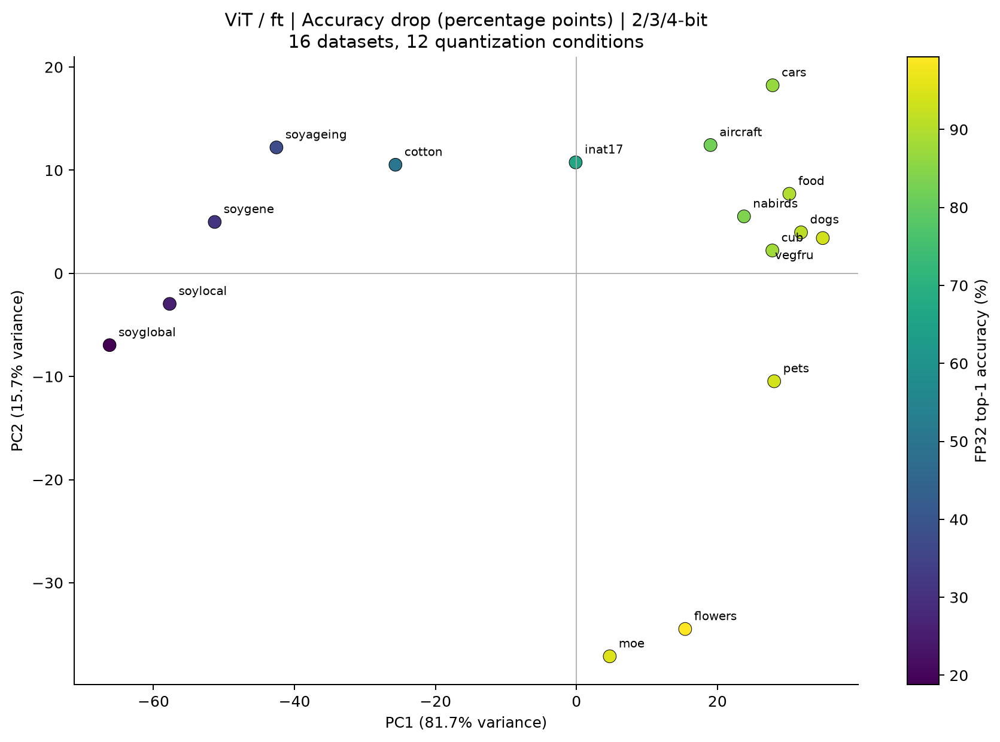
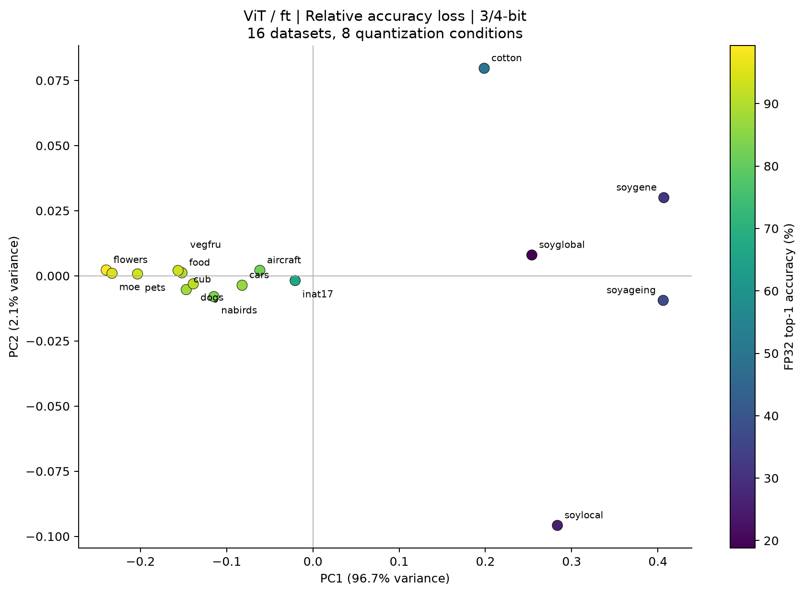

# Dataset quantization robustness：PCA 第一階段

## 問題與分析單位

在固定 model 與 checkpoint kind 的背景內，每列是一個 dataset-specific checkpoint，每欄是一組 bit width × group size。不同量化條件是同一 checkpoint 的重複量測，不是獨立訓練 seed。這個 PCA 描述退化曲線的差異，不能識別 dataset 單獨造成的效果。

主要數值是 `1 - accuracy_ratio`（relative loss）。Ratio 大於 1 時保留負 loss；`accuracy_drop_points = fp32_top1 - hqq_top1` 另行分析。沒有截斷或補值。PCA 對每個條件欄置中，但不除以其標準差，因此變異較大的條件可能主導 PC。

## ViT / ft 主要結果

主要矩陣有 **16 datasets × 12 conditions**。PC1 解釋 **84.4%**、PC2 解釋 **12.8%** 的 dataset 間曲線變異，合計 **97.2%**。PC1 與 FP32 baseline 的 Spearman ρ = **-0.94**（15 個 dataset 的描述值），因此 PC1 上的分離不能直接解釋成 dataset 固有的量化耐受度。

PC1 絕對值最大的 loading 是 **2-bit / group 32**（+0.67）；PC2 是 **2-bit / group 128**（+0.90）。解讀 PC 時須同看 loadings 與原始退化曲線；PC 座標軸的正負方向沒有固有意義。







## 指標、bit 範圍與模型背景敏感度

Absolute drop、僅 3/4-bit 的 relative loss，以及其他八個 model / checkpoint kind 各自重新擬合 PCA。不同 fit 的 PC 座標軸不能直接疊在一起比較。`distance_sensitivity.csv` 比較完整條件曲線中所有 dataset pair 距離的排序；dataset pair 彼此相依，這些 rho 只是描述值，沒有 p-value。ViT / ft 的 ratio 對 absolute drop 距離排序 ρ = **0.84**；去掉 2-bit 後 ρ = **0.87**。

| Model / checkpoint | Relative loss PC1+PC2 | Absolute drop PC1+PC2 | 3/4-bit PC1+PC2 | Distance rho: drop | Distance rho: 3/4-bit |
|---|---:|---:|---:|---:|---:|
| BEiTv2 / cal | 88.2% | 93.8% | 95.3% | 0.72 | 0.89 |
| BEiTv2 / ft | 90.8% | 94.2% | 92.2% | 0.46 | 0.85 |
| BEiTv2 / fz | 96.6% | 98.3% | 96.7% | 0.86 | 0.99 |
| Swin / cal | 93.2% | 88.3% | 99.4% | 0.81 | 0.81 |
| Swin / ft | 96.8% | 93.8% | 98.8% | 0.86 | 0.93 |
| Swin / fz | 98.2% | 96.2% | 99.4% | 0.93 | 0.96 |
| ViT / cal | 95.0% | 97.0% | 97.6% | 0.88 | 0.91 |
| ViT / ft | 97.2% | 97.4% | 98.8% | 0.84 | 0.87 |
| ViT / fz | 94.2% | 98.0% | 95.7% | 0.85 | 0.97 |





## 解讀界線

- Dataset、訓練結果與 dataset-specific checkpoint 仍混雜；每個 context 只有一個訓練 seed。
- 低 FP32 baseline 會使 relative loss 對小幅 absolute change 敏感。須一起查看 `fp32_top1`、absolute-drop PCA 與主分析的 baseline audit。
- PCA 最大化變異，不是 robustness 預測，也不會自動分離預先定義的 dataset 類別。圖中的群聚僅供探索。

## 重現方式

在 repository 根目錄執行：

```powershell
conda run -n opencode_env python -m dataset_robustness.pca_profiles
conda run -n opencode_env python -m dataset_robustness.verify_pca
```

來源：`C:\project\quant_analysis\legacy_hqq\result\20261115_weight_only_s10000_10016_audit\legacy\quant_summary.csv`。輸入 SHA-256：`540b3d90f188c94e992a3528ca809967d8b62ed7711d75d9fb950fdeca165786`。`run_config.json` 記錄程式與輸出雜湊；`coverage.csv` 保留完整性稽核；`scores.csv`、`loadings.csv`、`variance.csv` 保留數值。
