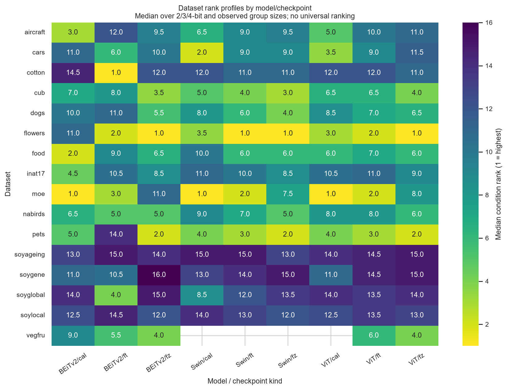
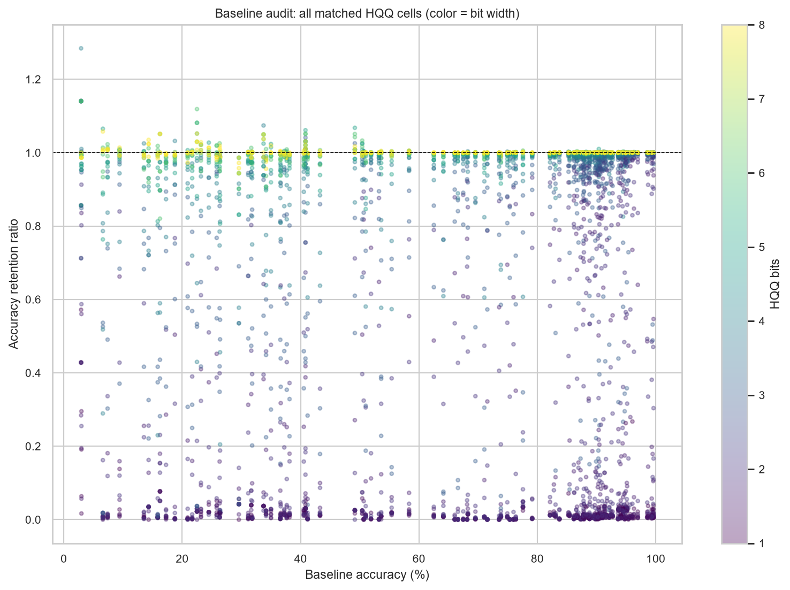

# Dataset quantization robustness：排名穩定性分析

這份報告回答：在目前 HQQ 實驗中，哪些 dataset 保留較多 accuracy，且相對優勢是否隨量化條件或模型背景改變？

## 主要結果

- 有效條件 **4,490** 筆；排除 0 筆；涵蓋 **16 datasets、3 models、3 checkpoint 類型**。
- 每條件 seed 數範圍：1–1。量化條件不是獨立訓練重複。
- 主要 2／3／4-bit 範圍內，固定 model／checkpoint 的條件間排名 Spearman ρ 中位數為 **0.801**，最小值 -0.488。
- 固定量化條件、改變 model／checkpoint 時，排名 ρ 中位數為 **0.541**，最小值 -0.300。
- 各 model／checkpoint 內的 dataset 配對中，**68.4%** 至少發生一次相對順序翻轉。分母是「dataset pair × model/checkpoint」，不是獨立樣本。
- 以上係數及比例均為描述性摘要；未設定「穩定」顯著性門檻，未強制生成全域總排名。

**解讀：** 目前結果較支持「在固定模型背景下存在相對穩定的 dataset 差異，但跨背景的可移植性較弱」。 存在先後順序翻轉，因此不給出適用所有條件的 dataset 總排名。

## 各模型背景的穩定程度

| model_name | ckpt_kind | rho_median | rho_min | undefined_comparisons | pair_reversal_fraction |
| --- | --- | --- | --- | --- | --- |
| BEiTv2 | cal | 0.701 | -0.026 | 0 | 0.692 |
| BEiTv2 | ft | 0.716 | -0.488 | 0 | 0.758 |
| BEiTv2 | fz | 0.909 | -0.215 | 0 | 0.683 |
| Swin | cal | 0.670 | 0.182 | 0 | 0.705 |
| Swin | ft | 0.925 | 0.107 | 0 | 0.590 |
| Swin | fz | 0.925 | 0.204 | 0 | 0.619 |
| ViT | cal | 0.855 | 0.111 | 0 | 0.648 |
| ViT | ft | 0.781 | 0.043 | 0 | 0.742 |
| ViT | fz | 0.838 | -0.171 | 0 | 0.700 |

`pair_reversal_fraction` 高代表更多 dataset 配對隨 bit/group 改變先後順序；它不衡量翻轉的幅度，應同時查看 pairwise_order_stability.csv 中的 ratio 差距。

## 哪些 dataset 在各背景下相對領先？

下表僅列各背景中「主要條件 rank 中位數最小」的 dataset（同分並列）。這是等權條件的描述，並非宣稱它在每一條件都最佳。完整名次範圍揭露其變動。

| model | checkpoint | datasets | median_rank | full_rank_range |
| --- | --- | --- | --- | --- |
| BEiTv2 | cal | moe | 1.000 | moe: 1–2 |
| BEiTv2 | ft | cotton | 1.000 | cotton: 1–16 |
| BEiTv2 | fz | flowers | 1.000 | flowers: 1–10 |
| Swin | cal | moe | 1.000 | moe: 1–5 |
| Swin | ft | flowers | 1.000 | flowers: 1–4 |
| Swin | fz | flowers | 1.000 | flowers: 1–5 |
| ViT | cal | moe | 1.000 | moe: 1–7 |
| ViT | ft | flowers、moe | 2.000 | flowers: 1–9; moe: 1–5 |
| ViT | fz | flowers | 1.000 | flowers: 1–5 |

各 dataset 跨背景的中位名次範圍如下；依 dataset 名稱排列，不建立總排名。

| dataset_name | n_contexts | best_context_median_rank | worst_context_median_rank | context_median_rank_span |
| --- | --- | --- | --- | --- |
| aircraft | 9 | 3.000 | 12.000 | 9.000 |
| cars | 9 | 2.000 | 11.500 | 9.500 |
| cotton | 9 | 1.000 | 14.500 | 13.500 |
| cub | 9 | 3.000 | 8.000 | 5.000 |
| dogs | 9 | 4.000 | 11.000 | 7.000 |
| flowers | 9 | 1.000 | 11.000 | 10.000 |
| food | 9 | 2.000 | 10.000 | 8.000 |
| inat17 | 9 | 4.500 | 11.000 | 6.500 |
| moe | 9 | 1.000 | 11.000 | 10.000 |
| nabirds | 9 | 5.000 | 9.000 | 4.000 |
| pets | 9 | 2.000 | 14.000 | 12.000 |
| soyageing | 9 | 13.000 | 15.000 | 2.000 |
| soygene | 9 | 10.500 | 16.000 | 5.500 |
| soyglobal | 9 | 4.000 | 15.000 | 11.000 |
| soylocal | 9 | 12.000 | 14.500 | 2.500 |
| vegfru | 5 | 4.000 | 9.000 | 5.000 |

## bit 範圍敏感度

| scope | median | min | count | pair_reversal_fraction |
| --- | --- | --- | --- | --- |
| full_grid | 0.288 | -0.776 | 4464 | 0.983 |
| primary | 0.801 | -0.488 | 594 | 0.684 |
| without_2bit | 0.897 | 0.236 | 252 | 0.398 |

primary = 2/3/4-bit；without_2bit = 3/4-bit；full_grid = 所有觀測 bit。每一範圍內，各 bit × group size 等權；範圍間條件數不同，翻轉比例不宜解讀為相同次數的重複檢定。極低 bit 的大幅退化與高 bit 接近 baseline 時的微小差異，皆可能造成排名翻轉；因此 full_grid 的較低一致性不等於所有實用量化條件都不穩定。scope_sensitivity.csv 保留每個 dataset 的中位名次及 ratio，供逐一比較。

## Baseline 與指標敏感度

主要條件內，ratio 排名與「掉分越少越好」排名的一致性 ρ 中位數為 0.871，最小值 -0.729。

Baseline 最低的 10 個 context（供稽核，並非排除門檻）：

| dataset_name | model_name | ckpt_kind | baseline_accuracy |
| --- | --- | --- | --- |
| cotton | BEiTv2 | ft | 2.920 |
| soyglobal | BEiTv2 | ft | 2.980 |
| soyglobal | BEiTv2 | fz | 6.600 |
| soyglobal | Swin | ft | 7.400 |
| soygene | BEiTv2 | ft | 9.420 |
| soyglobal | ViT | fz | 13.540 |
| soylocal | BEiTv2 | ft | 14.330 |
| soygene | BEiTv2 | fz | 15.870 |
| cotton | BEiTv2 | cal | 16.250 |
| soygene | ViT | fz | 17.270 |

低 baseline 會放大 ratio 對 accuracy 變動的反應。所有有效 context 均保留；dataset 整體低 baseline 與個別 model/checkpoint 異常必須分開判讀。同時檢查 baseline、HQQ accuracy 與掉分百分點，不能把 ratio 排名直接當成部署 accuracy 排名。

## 方法與納入規則

- Legacy summary 先在同 dataset、normalized model、完整 checkpoint 路徑與 seed 內配對。跨 serial 重複不是獨立 seed；本分析使用 summary 的配對 ratio。
- 主要 outcome 為 HQQ / FP32 accuracy ratio；輔助 outcome 為 FP32 − HQQ 的百分點差。Ratio > 1 不截斷，負掉分照實保留。
- 同 dataset/model/checkpoint 類型不允許多 checkpoint 路徑混合；遇到歧義會停止。
- 每個 model/checkpoint 與 bit 範圍使用所有指定條件皆存在的固定 dataset cohort。跨背景比較則在同量化條件下使用所有背景共同具備的 dataset，避免比較對象隨配對改變。
- coverage.csv 中被完整 cohort 規則排除的 dataset/context/scope 紀錄：3。
- Rank 1 為最高 ratio，同值採 average rank。Pairwise 比較的 1e-12 僅是浮點相等容差，不是實質差異門檻；不把微小差距自動解讀為有意義優勢。
- Spearman ρ 為配對 dataset 的秩相關。少於 3 個 dataset 或常數排名時記為 NA，不填成 0、不產生 p-value。所有中位數均不加樣本數權重。

## 設定品質與驗證缺口

- configuration_quality.csv 非固定欄位：batch_size；完全缺值欄位：host。缺值不代表設定已驗證固定。
- 目前只有單一 seed 的 context 無法估計跨訓練 seed 不確定性；32 個量化條件不能當成 32 個 seed。
- 這是 HQQ、既有模型與 dataset-specific checkpoint 下的關聯性比較；不能分離 dataset 與訓練結果，也不能推廣為 dataset 固有性質或所有 PTQ 方法的結論。
- 未新增 W&B 下載。既有 summary 無逐樣本預測，因此這份報告不估計 paired-image uncertainty 或 damage/rescue。
- 後續優先補多個獨立訓練 seed；對低 baseline checkpoint 核對訓練及評估設定；若要推廣到其他量化方法，再做同 checkpoint 的跨方法驗證。

## 可重現性與檔案

- 輸入：`C:\project\quant_analysis\legacy_hqq\result\20261115_weight_only_s10000_10016_audit\legacy\quant_summary.csv`
- SHA-256：`540b3d90f188c94e992a3528ca809967d8b62ed7711d75d9fb950fdeca165786`
- `cells.csv`：全部有效條件、baseline、掉分及逐條件排名。
- `dataset_profiles.csv`：每背景與分析範圍內的 ratio 與排名分布。
- `within_context_agreement.csv` / `cross_context_agreement.csv`：排名一致性。
- `pairwise_order_stability.csv`：dataset 配對勝負、翻轉與實際差距。
- `metric_agreement.csv` / `scope_sensitivity.csv`：指標與 bit 範圍敏感度。
- `baseline_audit.csv` / `coverage.csv` / `excluded_cells.csv`：資料稽核。
- `plots_manifest.csv`：所有圖片及其來源表；`run_config.json`：參數與來源指紋。
- `data/upstream/legacy/`：固定版本的上游 summary、稽核表、XLSX 與原有圖表。
