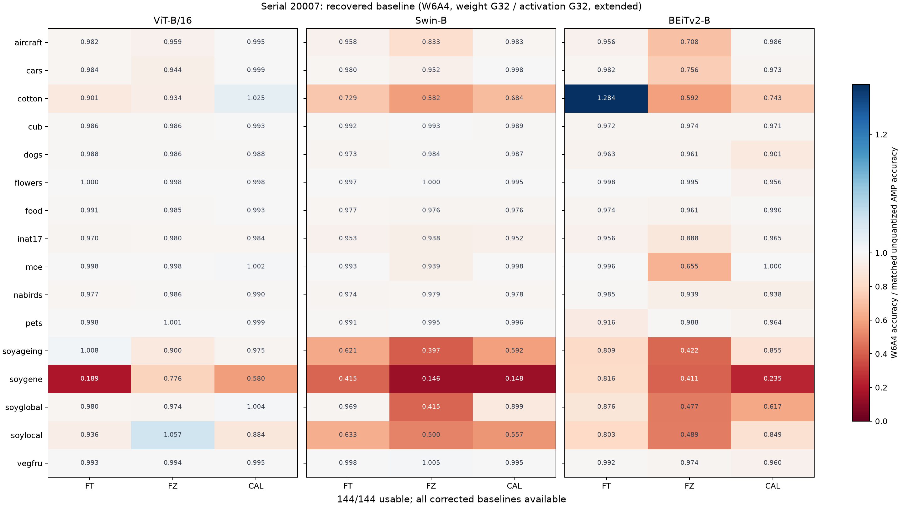

# Serial 20007 W6A4 分析

- Run ID：`20261021_162359_890951_w6a4_s20007`；狀態：`complete`。
- 輸入版本：`baseline_20261021`。
- 開始：2026-10-21T16:23:59.892250+08:00；結束：2026-10-21T16:24:02.795915+08:00（Asia/Taipei）。
- 分析耗時：2.904 秒。
- 完整輸出：`../../result/20261021_162359_890951_w6a4_s20007/`；完整機器紀錄：`../../result/20261021_162359_890951_w6a4_s20007/run.json`。

## 輸入與方法

W&B nycu_pcs/TiT 的既有 config/summary 快照；本次未下載資料、訓練或執行 GPU 推論。
16 datasets × 3 models × FT/FZ/CAL。量化為 W6A4、weight G32、activation G32、extended scope。
Baseline 是相容的未量化 AMP；accuracy_ratio = W6A4 top1 / baseline top1，accuracy 使用百分比，ratio 無單位。
核對完整 checkpoint 路徑、seed、classifier、precision 與已記錄的評估設定；ratio 不截斷。

| 輸入檔案 | SHA-256 |
|---|---|
| `selected_runs.jsonl` | `41975074b516744f58d74c1729bdfa1dd16472148fdbc23778b028b779eed603` |
| `cohort_receipt.json` | `0745d16e702d90cbfe4c5a3b25b1295b9a07583a2ed684b1e11f28e4a81247c1` |
| `serial_20007_runs.json` | `469e88e2dc16c664b96316b1f5ddc4b29f77c58bfe48495090bc04fecb93c35a` |
| `target_receipt.json` | `aa2db6d404b89c174aaf1c20e1434fa789cbc75fe94c4c12a6fed83e0dc59f96` |
| `reference_pairs.csv` | `278276872bb42727edf3e26aa4770c613758b747d105cb148fe4b768a9b96326` |
| `reference_receipt.json` | `c35e6526070027de899581904469b565064516b70d28d518d1fd20b642228f59` |

## 結果與核對

- 可配對 144/144 格；與遷移前參考表逐格比較 run IDs 與四個數值欄位。
- 公式與參考數值容差為 1e-12；對照細節見完整輸出 audit/verification.json。
- dogs、flowers、moe、pets、vegfru 的 BEiTv2 使用修正版 baseline；FT/FZ 為 cls，CAL 為 pool。
- 其餘 baseline 來自已驗證的歷史快照；來源與原 manifest 均保存在本分析 data/。
- Batch size 不同的配對：66 格，保留在配對表。



[可編輯 SVG](figures/acc_ratio_heatmap.svg)

## 限制與重現

這是既有評估的描述性比較。Config 與路徑匹配不等於 checkpoint bytes 相同；未提供共同權重 hash 時維持未驗證。
本分析未獨立驗證伺服器硬體、環境或新推論正確性；重算一致僅證明此快照的分析遷移。
Git commit：`bf21a91aeae657710c79137bc20522c647c69ee3`；dirty：`True`。
本次相關程式快照與 SHA-256 位於完整輸出的 provenance/source/ 與 run.json。

```powershell
conda run -n opencode_env python -m w6a4_analysis.run --input-id baseline_20261021 --run-id NEW_RUN_ID
conda run -n opencode_env python -m w6a4_analysis.run --verify-run 20261021_162359_890951_w6a4_s20007
```

重跑使用新的 run ID；原 run 固定保存。報告用圖與完整輸出圖片逐檔核對 SHA-256。
